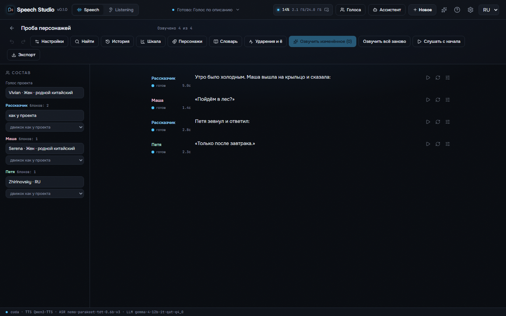
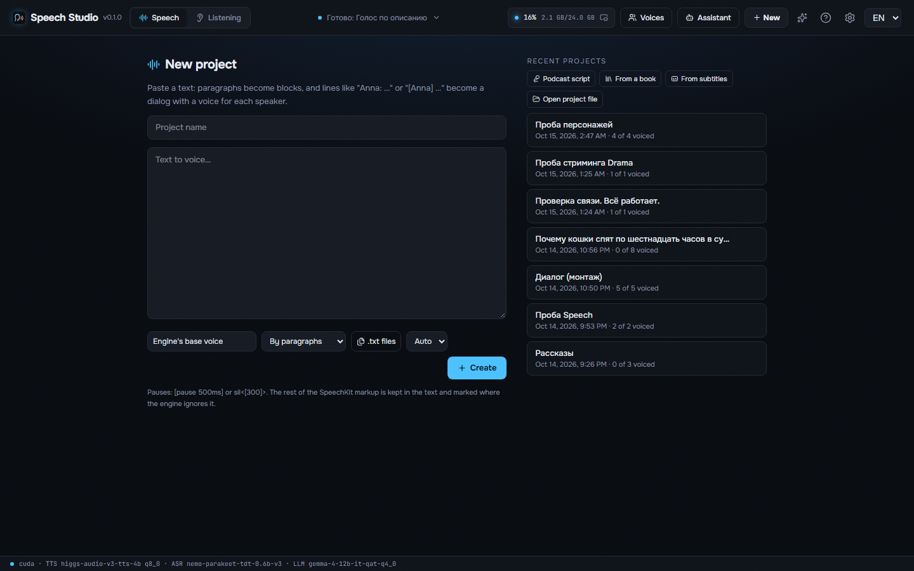
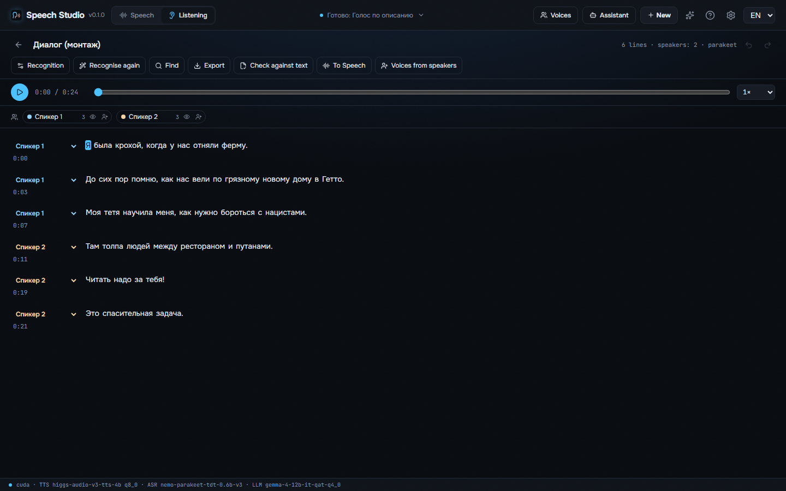
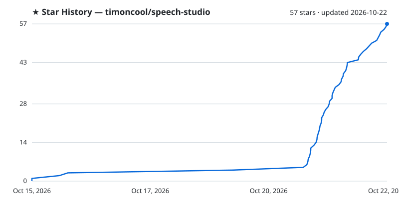

<div align="center">


# Speech Studio

**Free, offline AI voice studio for Windows — voice any text with cloned and built-in voices, and turn recordings into text with the speakers. Russian done right: numbers in their cases, stress marks, «ё» and homographs. 100% local, zero Python: one native `.exe` (Rust + C++/CUDA); every model and engine downloads with a button.**

[](LICENSE)
[](https://github.com/timoncool/speech-studio/stargazers)
[](https://github.com/timoncool/speech-studio/releases)
[](https://github.com/timoncool/speech-studio/releases)
[](https://github.com/timoncool/speech-studio/commits)

**English** · [Русский](README.ru.md) · [中文](README.zh.md) · [Español](README.es.md) · [Português](README.pt.md) · [Français](README.fr.md)



</div>

## What it is

**Speech Studio** has three modes. **Speech** voices text: a line, a dialog with a voice per character, a podcast the director writes for you, or a whole book from EPUB, FB2, PDF or DOCX. **Listening** turns a recording, a video or a link into text with who said what and when, cuts it by its words, checks a voicing against the text it should say and makes library voices from its speakers. **Live** is a voice conversation with an AI agent connected over MCP: it says each phrase as soon as it writes it and hears you through the microphone.

Everything runs **locally on your machine** — no cloud, no subscription; your texts, recordings and voiceprints never leave your computer. If you want a voice your card can't run, the cloud voices of **OpenRouter**, **Google Gemini**, **fal.ai** and **Runware** are there too, each behind its own key and a confirmation before the first call; they are off by default.

It's a **fully native app**: no embeddable Python, no torch, no CUDA wheels. The whole studio is **Rust + native C++/CUDA engines (GGUF/ONNX)** in one process. Models, engines, the CUDA and VC++ runtimes and ffmpeg are **downloaded by the app itself** on first run, and a model another of the author's studios already has is taken from it instead of downloaded again. **An NVIDIA GPU is what the app is built and tested for**; see *What runs where* for the rest.

## For AI agents

While Speech Studio is open it serves MCP at `http://127.0.0.1:8797/mcp`: an agent such as Claude Code, Claude Desktop, Cursor or Codex does everything the window does, through the same code — voices a text into a file in one call, makes and edits projects block by block, casts voices to characters, designs a voice from a description, transcribes and checks recordings, exports audiobooks with chapters and subtitles. Settings, **Agent (MCP)** shows whether an agent is connected and what to paste into the client.

1. Install the studio from the [latest release](https://github.com/timoncool/speech-studio/releases/latest) and start it.
2. Connect to its MCP server:
   ```bash
   claude mcp add --transport http speech-studio http://127.0.0.1:8797/mcp
   ```
   Other clients: `{ "mcpServers": { "speech-studio": { "type": "streamable-http", "url": "http://127.0.0.1:8797/mcp" } } }`
3. Read the skill the server serves (resource `studio://skill`), the same text as [docs/mcp-skill.md](docs/mcp-skill.md), and start with the tool `studio_status`.

The studio also speaks the OpenAI audio API on the same port — `POST /v1/audio/speech`, `POST /v1/audio/transcriptions`, `GET /v1/models` — so tools written for OpenAI voice and transcribe through it, with a library voice's name as `voice`. [llms.txt](llms.txt) says the same for tools that look for it. Only programs on this computer may connect.

## What you can make with it

- **An audiobook** — drop an EPUB or FB2: chapters, characters with their own voices, an M4B with chapters and cover, ACX loudness checked.
- **A podcast or a dialog** — the director writes a podcast on a topic for two or three speakers, or paste lines like «Anna: …»; the timeline shows every overlap.
- **A voice-over for a video** — voice a script or subtitles into their cues, lay music and sounds under it in the track editor, export at the video's loudness.
- **A transcript of an interview or a lecture** — who said what and when, word times, subtitles by broadcasters' rules, the recording cut by its text.
- **A check of a dubbing** — lay the script over the recording and see every word said wrong or skipped.
- **Your own voice library** — record or import voices, clean them, make voices from the speakers of a recording.
- **A voice for your AI agent** — talk with Claude Code or any MCP agent in Live, or let it voice and transcribe files through MCP or the OpenAI-compatible API.

Examples of every engine and voice, with Russian stress before and after, are on the [project page](https://timoncool.github.io/speech-studio/).

## Three modes

| Mode | What it does |
|------|--------------|
| 🔊 **Speech** | Text, dialog, podcast or book → voiced blocks with takes, checked by ear, exported as WAV, FLAC, MP3, OGG, M4A or M4B with chapters, subtitles and synced text |
| 👂 **Listening** | Audio, video or a link → a transcript with speakers and word times, a karaoke player, cut-by-text, export to SRT, VTT, ASS, TXT or JSON, a check against a reference text |
| 🎙️ **Live** | A voice conversation with an AI agent: the agent connected over MCP speaks each phrase as it writes it, you answer into the microphone and are recognised phrase by phrase, speaking over it stops it; mute with M or Ctrl+Shift+Space, a widget over every window |

## Features

**Voices and engines**

- **Five local engines** — [Higgs Audio v3](https://huggingface.co/bosonai) (cloning, emotions and sounds), **Fish Audio Drama 3** (the strongest open voice; the whole model on a 24 GB card, from 6 GB with its experts in RAM), **Supertonic 3** (fast, ten built-in voices), **Qwen3-TTS 1.7B** (nine built-in voices, cloning, an instruction per block) and **Qwen3-TTS with Russian stress**, siriusfreak's LoRA applied at run time.
- **Engine per character and per block** over the project's own; an engine that can't speak the voice in use says which of its voices it takes.
- **Voice library** — a voice pack in one click, 743 Russian voices from the cloud catalogue, recording from the microphone, import of files and ZIPs, photo, gender, age, language, tags and consent; the reference transcript is recognised once and kept.
- **Clean a reference** — Mel-Band Roformer takes the voice from music, **DPDFNet** takes noise away with a strength control so speech stays alive; the original is kept.
- **Best piece of a reference** — windows at pauses between recognised words, each with its length, signal-to-noise, clipping and longest pause.
- **Voice by description** — Qwen3-TTS VoiceDesign makes a voice from "an elderly woman with a soft, slightly hoarse voice…": hear several candidates, keep one in the library.

- **Cloud voices** — OpenRouter, Google Gemini (parallel requests or Batch at half the price), fal.ai and Runware, each behind its own key and a confirmation before the first call.

**Text that sounds right**

- **Russian normaliser** — numbers in the right case and gender, dates, times, money, units, Roman numerals, Latin brand names and abbreviations.
- **Stress, «ё» and homographs** by RUAccent — the large homograph model (big_poetry in int8, the same choices as fp32) picks замо́к or за́мок by the sentence; doubtful ones are highlighted for you, your own `+` marks stay.
- **Pronunciation dictionary** — replace, regex and phonemes, scoped to the project, a language, a voice or an engine, Balabolka `.rex`/`.dic`/`.bxd` import, and a check by ear right from the dictionary.
- **SpeechKit-compatible markup** — `+` stress, `sil<[300]>` and `[pause 500ms]` pauses, `[rate:1.2]` tempo, `**accent**`; what an engine ignores is marked, never silently dropped.

- **More of the text read right** — an SSML subset, prosody hints coloured word by word, phone numbers, e-mail addresses and codes, a passage in another language in the same voice, and a check of the script before voicing.

**Projects**

- **Text as the timeline** — blocks with speakers, takes (up to five), stale tracking, undo and redo, drag to reorder, search and replace with regex, notes and markers.
- **Quality control** — every take recognised back and compared word by word, plus checks for clipping, silence, cut-off, a click at the end, a repeated phrase, a long tail, music or noise instead of speech, and similarity to the reference voice; several takes with the best one picked.
- **Dialog and podcasts** — `Anna:` and `[Anna]` lines become characters, the director writes a podcast on a topic for N speakers, negative pauses make interruptions, and the **timeline** shows every overlap with cut, join or keep.
- **Audiobooks** — EPUB, FB2, PDF, DOCX, HTML, Markdown and TXT with chapter preview, cast by the director, M4B with chapters and cover, parts for long books, ACX loudness check.
- **Subtitles as a project** — SRT, VTT and ASS lines voiced into their cues: the tempo raised ahead, a retry when a take doesn't fit, then stretching and borrowing the silence before the line.
- **Export check** — blocks missing, stale, failed, with a changed file or too long for their cue are listed before export; only the length may be allowed through.
- **Loudness** — video (−14 LUFS), podcast (−16 LUFS) and ACX presets with a true-peak limiter, room tone and breaths between blocks.
- **Project file** — `.speechproj` with text, voices and audio carries a project to another computer.

- **Montage** — a track editor under the text: move, trim, fade and level each clip, music and sound tracks from files or folders, or a song made right there in YuE2, MiniMax Music3 or ACE-Step Studio.
- **Export for every use** — a file per chapter, a track per character in a ZIP, a CSV table of lines, voice effects (radio, phone, loudspeaker), even loudness of pieces, sample rate and bit depth, file name templates, a SHA-256 manifest and a note on how it was made.
- **Compare and approve** — A/B of takes, a blind comparison of engines on the same text, approved blocks a re-voicing leaves alone, a quality traffic light and a project report.
- **Books and plays** — direct speech apart from the author's, a cast of characters with voices picked for them, footnotes cleaned out, the book's names into the dictionary, a project updated from a corrected book without losing what is voiced, and an HTML player of the book.

**Listening**

- **Parakeet-TDT and Nemotron 3.5 (28 languages with punctuation) on transcribe.cpp, or Whisper**, up to eight speakers by Nemotron 3 Diarization, a long recording cut at pauses by **Silero VAD v6**, noise removed by DPDFNet, music removed by Roformer.
- **A hint for Whisper** — topic and spellings, plus the corrections you add.
- **Batch** — drop several files at once; each becomes a recording queued for recognition.
- **Lay a known text over the recording** — the reference text takes the time of each heard word, sentence by sentence.
- **Voices from speakers** — a library voice from each speaker's cleanest words.

- **As you speak** — recognition from the microphone phrase by phrase, a watched folder recognised in the background, quick recognition without the editor.
- **The right model by itself** — with the language on Auto, VoxLingua107 finds it and the recording goes to a recogniser that knows it; the chosen model downloads the first time it is used.
- **Subtitles by broadcasters' rules** (Netflix, BBC and others), who talks how much, numbers as digits in export.

**Live**

- **A conversation by voice** — the agent connected over MCP says each phrase as soon as it writes it; you answer into the microphone and are recognised phrase by phrase; speaking over the agent stops it; a typed line reaches the agent like a spoken one.
- **Changes on the fly** — the agent's voice, the recogniser, the language and the microphone can be changed in the middle of a conversation: the microphone restarts with the new choice, and the window says «Loading the voice…» while a new voice's engine loads.
- **A natural pace** — an agent's sentence is said whole up to 300 characters, a pause an engine leaves inside a phrase is heard at most 0.6 s long, and each phrase is heard once.
- **Microphone and sound** — mute with M or Ctrl+Shift+Space from any window (hold to talk), level meters, hearing yourself back, a speaker test and the agent's volume.
- **Five looks and a widget** — aura, wave, bars, radial and matrix, and a small widget over every window; Ctrl+3 opens Live.
- **Measured** — your phrase is text 0.64–0.74 s after you stop speaking (Parakeet on an RTX 4090), and the first sound of the answer comes 15 ms to 1 s after the agent writes it, by engine.

**Everywhere**

- **OpenAI-compatible API**, **MCP** with window control for agents, an assistant panel on an OpenRouter model with the same tools.
- **Diagnostics** — graphics card, driver, CUDA, libraries, logs, a bug-report package without keys.
- **The whole app in six languages**, light and dark theme, auto-update, fully portable.
- **First run asks only what you want** — voices, recognition and extras; engines, libraries and the build for your card come with them, one line each with its size.
- **Command palette** (Ctrl+K), your own hotkeys, a simple mode and a «?» hint on every control.

## Measured speed

On one computer: RTX 4090 (24 GB) under Windows 11, Speech Studio as it installs.

**Voicing** — Speech Studio 0.2.0, the same 17-second Russian text, the second run of each engine (its model loaded); first sound is the time until audio starts in the window, video memory the peak while speaking.

| Engine | Faster than real time | First sound | Streaming | Download | Video memory |
|---|---|---|---|---|---|
| Supertonic 3 | 168× | 103 ms | by phrase | 0.1 GB | 1.0 GB |
| Qwen3-TTS | 12× | 19 ms | as it speaks | 2.2 GB | 3.1 GB |
| Qwen3-TTS + ru stress LoRA | 10× | 26 ms | as it speaks | 2.3 GB | 3.5 GB |
| Fish Audio Drama 3 | 7.0× | 326 ms | as it speaks | 21.4 GB | 21.9 GB |
| Higgs Audio v3 | 2.3× | 1.0 s | as it speaks | 5.3 GB | 18.1 GB |

**Recognition** — Speech Studio 0.2.1, one 5-minute Russian recording of one speaker (299.7 s) in Listening without telling speakers apart, the model loading included; the model leaves video memory when the job ends.

| Model | On the card | On the processor | Languages | Download | Video memory |
|---|---|---|---|---|---|
| Parakeet TDT v3 | 96× (3.1 s) | 33× (9.2 s) | 25 | 0.7 GB | 1.2 GB |
| Parakeet Ultra | 73× (4.1 s) | 33× (9.2 s) | 25 | 0.7 GB | 1.0 GB |
| Nemotron 3.5 | 73× (4.1 s) | 29× (10.3 s) | 28 | 0.7 GB | 1.0 GB |
| Whisper large-v3-turbo | 19× (15.4 s) | 2.2× (134 s) | 99 | 1.6 GB | 1.6 GB |

**Live** — one turn of a conversation.

| Step | Time |
|---|---|
| Your phrase as text after you stop speaking (Parakeet on the card, the pause that ends a phrase included) | 0.64–0.74 s |
| The agent writes its answer (Claude Sonnet) | 2.0–3.9 s |
| First sound of the answer (by engine, see Voicing) | 15 ms – 1.0 s |

## Screenshots

The start screen — a text, a book, subtitles or a podcast script becomes a project:



Listening — a transcript with speakers and word times, a karaoke player, cut-by-text and export:



## Requirements

- **OS:** Windows 10 / 11 (x64); Linux x86-64 as an experimental build
- **GPU:** NVIDIA with 8 GB of VRAM or more and a recent driver; Drama 3 runs whole on 24 GB; from 6 GB its experts (18 GB) live in RAM, which then needs 32 GB, and the VRAM it takes is set in Settings (Auto or 5 to 24 GB). Without NVIDIA only the CPU and cloud paths of *What runs where* run, and that setup is not tested
- **WebView2** — preinstalled on Windows 11; on Windows 10 the installer fetches it
- **Disk:** about 9 GB for the default models, engines and runtime, plus what you add (Drama 3 is 23 GB)

On an NVIDIA machine the only thing you install by hand is a recent **[NVIDIA driver](https://www.nvidia.com/Download/index.aspx)**.

## Quick start

1. **Download** the portable build from [Releases](https://github.com/timoncool/speech-studio/releases) and unzip anywhere (or install via `-setup.exe` / `.msi`).
2. **Run** `Speech Studio.exe`.
3. On the **First run** panel press **Download selected** — the app fetches models, engines and runtime once.
4. **Paste a text** and press **Create**, or switch to **Listening** and drop a recording.

> Everything downloads and lives **inside the app folder**: models, caches, voices and projects go nowhere else.

What changed and when is in [CHANGELOG.md](CHANGELOG.md), and the sparkles button at the top of the app shows it. Rules for contributors and coding agents: [AGENTS.md](AGENTS.md).

## Everything the app downloads

The first-run panel fetches all of this with a button. Behind a proxy, or where Hugging Face is blocked, set the proxy in Settings → **Network**. You can also download the direct files yourself, put them where the last column says, counted from the app folder, and press **Import from folder**; archive components the app downloads itself. Every file is checked against its pinned SHA-256 before it is used. Sizes and hashes come from the app's manifest, `crates/speech-server/src/setup.rs`, and this table is checked against it.

<!-- downloads:start -->
| Component | Need | Files (direct links) | Size | Put it in |
|---|---|---|---|---|
| Higgs Audio v3 Q8_0 | required | [q8_0.gguf](https://huggingface.co/drbaph/Higgs-Audio-v3-Studio/resolve/c6e9db5a2062c15accc1b9bfa54d927bbdb124dc/models/higgs-q8_0/q8_0.gguf) → `models\higgs-q8_0\q8_0.gguf`<br>[config.json](https://huggingface.co/drbaph/Higgs-Audio-v3-Studio/resolve/c6e9db5a2062c15accc1b9bfa54d927bbdb124dc/models/higgs-q8_0/config.json) → `models\higgs-q8_0\config.json`<br>[chat_template.jinja](https://huggingface.co/drbaph/Higgs-Audio-v3-Studio/resolve/c6e9db5a2062c15accc1b9bfa54d927bbdb124dc/models/higgs-q8_0/chat_template.jinja) → `models\higgs-q8_0\chat_template.jinja`<br>[tokenizer.json](https://huggingface.co/drbaph/Higgs-Audio-v3-Studio/resolve/c6e9db5a2062c15accc1b9bfa54d927bbdb124dc/models/higgs-q8_0/tokenizer.json) → `models\higgs-q8_0\tokenizer.json`<br>[tokenizer_config.json](https://huggingface.co/drbaph/Higgs-Audio-v3-Studio/resolve/c6e9db5a2062c15accc1b9bfa54d927bbdb124dc/models/higgs-q8_0/tokenizer_config.json) → `models\higgs-q8_0\tokenizer_config.json`<br>[higgs_audio_v2_tokenizer_config.json](https://huggingface.co/drbaph/Higgs-Audio-v3-Studio/resolve/c6e9db5a2062c15accc1b9bfa54d927bbdb124dc/models/higgs-q8_0/higgs_audio_v2_tokenizer_config.json) → `models\higgs-q8_0\higgs_audio_v2_tokenizer_config.json` | 5.5 GB | as is, to the path after the arrow |
| audiocpp_engine.dll (Higgs engine) | required | [audiocpp_engine.dll](https://github.com/timoncool/Higgs-Ultimate/releases/download/engine-0.2.3-turing/audiocpp_engine.dll) → `models\higgs-engine\audiocpp_engine.dll` | 129 MB | as is, to the path after the arrow |
| Gemma-4 12B QAT q4_0 + vision | optional | [gemma-4-12b-it-qat-q4_0.gguf](https://huggingface.co/google/gemma-4-12b-it-qat-q4_0-gguf/resolve/2b318d6ebebf093f50ca4376e858325f10703358/gemma-4-12b-it-qat-q4_0.gguf) → `models\mt\gemma-4-12b-it-qat-q4_0.gguf`<br>[mmproj-gemma-4-12b-it-qat-q4_0.gguf](https://huggingface.co/google/gemma-4-12b-it-qat-q4_0-gguf/resolve/2b318d6ebebf093f50ca4376e858325f10703358/mmproj-gemma-4-12b-it-qat-q4_0.gguf) → `models\mt\mmproj-gemma-4-12b-it-qat-q4_0.gguf` | 7.2 GB | as is, to the path after the arrow |
| Gemma-4 12B Q5_K_M + vision | optional | [gemma-4-12b-it-Q5_K_M.gguf](https://huggingface.co/unsloth/gemma-4-12b-it-GGUF/resolve/d997c805aafe035a8024f961c6e1afd6b30d79a5/gemma-4-12b-it-Q5_K_M.gguf) → `models\mt-q5_0\gemma-4-12b-it-Q5_K_M.gguf`<br>[mmproj-F16.gguf](https://huggingface.co/unsloth/gemma-4-12b-it-GGUF/resolve/d997c805aafe035a8024f961c6e1afd6b30d79a5/mmproj-F16.gguf) → `models\mt-q5_0\mmproj-F16.gguf` | 8.6 GB | as is, to the path after the arrow |
| Gemma-4 12B Q6_K + vision | optional | [gemma-4-12b-it-Q6_K.gguf](https://huggingface.co/unsloth/gemma-4-12b-it-GGUF/resolve/d997c805aafe035a8024f961c6e1afd6b30d79a5/gemma-4-12b-it-Q6_K.gguf) → `models\mt-q6_k\gemma-4-12b-it-Q6_K.gguf`<br>[mmproj-F16.gguf](https://huggingface.co/unsloth/gemma-4-12b-it-GGUF/resolve/d997c805aafe035a8024f961c6e1afd6b30d79a5/mmproj-F16.gguf) → `models\mt-q6_k\mmproj-F16.gguf` | 10.0 GB | as is, to the path after the arrow |
| Gemma-4 12B Q8_0 + vision | optional | [gemma-4-12b-it-Q8_0.gguf](https://huggingface.co/unsloth/gemma-4-12b-it-GGUF/resolve/d997c805aafe035a8024f961c6e1afd6b30d79a5/gemma-4-12b-it-Q8_0.gguf) → `models\mt-q8_0\gemma-4-12b-it-Q8_0.gguf`<br>[mmproj-F16.gguf](https://huggingface.co/unsloth/gemma-4-12b-it-GGUF/resolve/d997c805aafe035a8024f961c6e1afd6b30d79a5/mmproj-F16.gguf) → `models\mt-q8_0\mmproj-F16.gguf` | 12.8 GB | as is, to the path after the arrow |
| Parakeet-TDT 0.6B v3 Q8_0 (transcribe.cpp) | required | [parakeet-tdt-0.6b-v3-Q8_0.gguf](https://huggingface.co/handy-computer/parakeet-tdt-0.6b-v3-gguf/resolve/d8d8c32cb2017c57e5307767343e97870f8a7f53/parakeet-tdt-0.6b-v3-Q8_0.gguf) → `models\asr-gguf-parakeet-v3\parakeet-tdt-0.6b-v3-Q8_0.gguf` | 740 MB | as is, to the path after the arrow |
| Higgs Audio v3 Q6_K | optional | [q6_k.gguf](https://huggingface.co/drbaph/Higgs-Audio-v3-Studio/resolve/c6e9db5a2062c15accc1b9bfa54d927bbdb124dc/models/higgs-q6_k/q6_k.gguf) → `models\higgs-q6_k\q6_k.gguf`<br>[config.json](https://huggingface.co/drbaph/Higgs-Audio-v3-Studio/resolve/c6e9db5a2062c15accc1b9bfa54d927bbdb124dc/models/higgs-q6_k/config.json) → `models\higgs-q6_k\config.json`<br>[chat_template.jinja](https://huggingface.co/drbaph/Higgs-Audio-v3-Studio/resolve/c6e9db5a2062c15accc1b9bfa54d927bbdb124dc/models/higgs-q6_k/chat_template.jinja) → `models\higgs-q6_k\chat_template.jinja`<br>[tokenizer.json](https://huggingface.co/drbaph/Higgs-Audio-v3-Studio/resolve/c6e9db5a2062c15accc1b9bfa54d927bbdb124dc/models/higgs-q6_k/tokenizer.json) → `models\higgs-q6_k\tokenizer.json`<br>[tokenizer_config.json](https://huggingface.co/drbaph/Higgs-Audio-v3-Studio/resolve/c6e9db5a2062c15accc1b9bfa54d927bbdb124dc/models/higgs-q6_k/tokenizer_config.json) → `models\higgs-q6_k\tokenizer_config.json`<br>[higgs_audio_v2_tokenizer_config.json](https://huggingface.co/drbaph/Higgs-Audio-v3-Studio/resolve/c6e9db5a2062c15accc1b9bfa54d927bbdb124dc/models/higgs-q6_k/higgs_audio_v2_tokenizer_config.json) → `models\higgs-q6_k\higgs_audio_v2_tokenizer_config.json` | 5.0 GB | as is, to the path after the arrow |
| Higgs Audio v3 Q4_K_M | optional | [q4_k_m.gguf](https://huggingface.co/drbaph/Higgs-Audio-v3-Studio/resolve/c6e9db5a2062c15accc1b9bfa54d927bbdb124dc/models/higgs-q4_k_m/q4_k_m.gguf) → `models\higgs-q4_k_m\q4_k_m.gguf`<br>[config.json](https://huggingface.co/drbaph/Higgs-Audio-v3-Studio/resolve/c6e9db5a2062c15accc1b9bfa54d927bbdb124dc/models/higgs-q4_k_m/config.json) → `models\higgs-q4_k_m\config.json`<br>[chat_template.jinja](https://huggingface.co/drbaph/Higgs-Audio-v3-Studio/resolve/c6e9db5a2062c15accc1b9bfa54d927bbdb124dc/models/higgs-q4_k_m/chat_template.jinja) → `models\higgs-q4_k_m\chat_template.jinja`<br>[tokenizer.json](https://huggingface.co/drbaph/Higgs-Audio-v3-Studio/resolve/c6e9db5a2062c15accc1b9bfa54d927bbdb124dc/models/higgs-q4_k_m/tokenizer.json) → `models\higgs-q4_k_m\tokenizer.json`<br>[tokenizer_config.json](https://huggingface.co/drbaph/Higgs-Audio-v3-Studio/resolve/c6e9db5a2062c15accc1b9bfa54d927bbdb124dc/models/higgs-q4_k_m/tokenizer_config.json) → `models\higgs-q4_k_m\tokenizer_config.json`<br>[higgs_audio_v2_tokenizer_config.json](https://huggingface.co/drbaph/Higgs-Audio-v3-Studio/resolve/c6e9db5a2062c15accc1b9bfa54d927bbdb124dc/models/higgs-q4_k_m/higgs_audio_v2_tokenizer_config.json) → `models\higgs-q4_k_m\higgs_audio_v2_tokenizer_config.json` | 4.1 GB | as is, to the path after the arrow |
| Fish Audio Drama 3 Q4 + drama_engine (6 GB+ GPU, 32 GB RAM under 24 GB) | optional | [.gitattributes](https://huggingface.co/apiplant/drama-q4/resolve/1fce9bd21d46a0311294aebfad19f994df90902f/.gitattributes) → `models\drama3\.gitattributes`<br>[LICENSE](https://huggingface.co/apiplant/drama-q4/resolve/1fce9bd21d46a0311294aebfad19f994df90902f/LICENSE) → `models\drama3\LICENSE`<br>[NOTICE](https://huggingface.co/apiplant/drama-q4/resolve/1fce9bd21d46a0311294aebfad19f994df90902f/NOTICE) → `models\drama3\NOTICE`<br>[README.md](https://huggingface.co/apiplant/drama-q4/resolve/1fce9bd21d46a0311294aebfad19f994df90902f/README.md) → `models\drama3\README.md`<br>[codec.safetensors](https://huggingface.co/apiplant/drama-q4/resolve/1fce9bd21d46a0311294aebfad19f994df90902f/codec.safetensors) → `models\drama3\codec.safetensors`<br>[drama.json](https://huggingface.co/apiplant/drama-q4/resolve/1fce9bd21d46a0311294aebfad19f994df90902f/drama.json) → `models\drama3\drama.json`<br>[globals.safetensors](https://huggingface.co/apiplant/drama-q4/resolve/1fce9bd21d46a0311294aebfad19f994df90902f/globals.safetensors) → `models\drama3\globals.safetensors`<br>[layer00.safetensors](https://huggingface.co/apiplant/drama-q4/resolve/1fce9bd21d46a0311294aebfad19f994df90902f/layer00.safetensors) → `models\drama3\layer00.safetensors`<br>[layer01.safetensors](https://huggingface.co/apiplant/drama-q4/resolve/1fce9bd21d46a0311294aebfad19f994df90902f/layer01.safetensors) → `models\drama3\layer01.safetensors`<br>[layer02.safetensors](https://huggingface.co/apiplant/drama-q4/resolve/1fce9bd21d46a0311294aebfad19f994df90902f/layer02.safetensors) → `models\drama3\layer02.safetensors`<br>[layer03.safetensors](https://huggingface.co/apiplant/drama-q4/resolve/1fce9bd21d46a0311294aebfad19f994df90902f/layer03.safetensors) → `models\drama3\layer03.safetensors`<br>[layer04.safetensors](https://huggingface.co/apiplant/drama-q4/resolve/1fce9bd21d46a0311294aebfad19f994df90902f/layer04.safetensors) → `models\drama3\layer04.safetensors`<br>[layer05.safetensors](https://huggingface.co/apiplant/drama-q4/resolve/1fce9bd21d46a0311294aebfad19f994df90902f/layer05.safetensors) → `models\drama3\layer05.safetensors`<br>[layer06.safetensors](https://huggingface.co/apiplant/drama-q4/resolve/1fce9bd21d46a0311294aebfad19f994df90902f/layer06.safetensors) → `models\drama3\layer06.safetensors`<br>[layer07.safetensors](https://huggingface.co/apiplant/drama-q4/resolve/1fce9bd21d46a0311294aebfad19f994df90902f/layer07.safetensors) → `models\drama3\layer07.safetensors`<br>[layer08.safetensors](https://huggingface.co/apiplant/drama-q4/resolve/1fce9bd21d46a0311294aebfad19f994df90902f/layer08.safetensors) → `models\drama3\layer08.safetensors`<br>[layer09.safetensors](https://huggingface.co/apiplant/drama-q4/resolve/1fce9bd21d46a0311294aebfad19f994df90902f/layer09.safetensors) → `models\drama3\layer09.safetensors`<br>[layer10.safetensors](https://huggingface.co/apiplant/drama-q4/resolve/1fce9bd21d46a0311294aebfad19f994df90902f/layer10.safetensors) → `models\drama3\layer10.safetensors`<br>[layer11.safetensors](https://huggingface.co/apiplant/drama-q4/resolve/1fce9bd21d46a0311294aebfad19f994df90902f/layer11.safetensors) → `models\drama3\layer11.safetensors`<br>[layer12.safetensors](https://huggingface.co/apiplant/drama-q4/resolve/1fce9bd21d46a0311294aebfad19f994df90902f/layer12.safetensors) → `models\drama3\layer12.safetensors`<br>[layer13.safetensors](https://huggingface.co/apiplant/drama-q4/resolve/1fce9bd21d46a0311294aebfad19f994df90902f/layer13.safetensors) → `models\drama3\layer13.safetensors`<br>[layer14.safetensors](https://huggingface.co/apiplant/drama-q4/resolve/1fce9bd21d46a0311294aebfad19f994df90902f/layer14.safetensors) → `models\drama3\layer14.safetensors`<br>[layer15.safetensors](https://huggingface.co/apiplant/drama-q4/resolve/1fce9bd21d46a0311294aebfad19f994df90902f/layer15.safetensors) → `models\drama3\layer15.safetensors`<br>[layer16.safetensors](https://huggingface.co/apiplant/drama-q4/resolve/1fce9bd21d46a0311294aebfad19f994df90902f/layer16.safetensors) → `models\drama3\layer16.safetensors`<br>[layer17.safetensors](https://huggingface.co/apiplant/drama-q4/resolve/1fce9bd21d46a0311294aebfad19f994df90902f/layer17.safetensors) → `models\drama3\layer17.safetensors`<br>[layer18.safetensors](https://huggingface.co/apiplant/drama-q4/resolve/1fce9bd21d46a0311294aebfad19f994df90902f/layer18.safetensors) → `models\drama3\layer18.safetensors`<br>[layer19.safetensors](https://huggingface.co/apiplant/drama-q4/resolve/1fce9bd21d46a0311294aebfad19f994df90902f/layer19.safetensors) → `models\drama3\layer19.safetensors`<br>[layer20.safetensors](https://huggingface.co/apiplant/drama-q4/resolve/1fce9bd21d46a0311294aebfad19f994df90902f/layer20.safetensors) → `models\drama3\layer20.safetensors`<br>[layer21.safetensors](https://huggingface.co/apiplant/drama-q4/resolve/1fce9bd21d46a0311294aebfad19f994df90902f/layer21.safetensors) → `models\drama3\layer21.safetensors`<br>[layer22.safetensors](https://huggingface.co/apiplant/drama-q4/resolve/1fce9bd21d46a0311294aebfad19f994df90902f/layer22.safetensors) → `models\drama3\layer22.safetensors`<br>[layer23.safetensors](https://huggingface.co/apiplant/drama-q4/resolve/1fce9bd21d46a0311294aebfad19f994df90902f/layer23.safetensors) → `models\drama3\layer23.safetensors`<br>[layer24.safetensors](https://huggingface.co/apiplant/drama-q4/resolve/1fce9bd21d46a0311294aebfad19f994df90902f/layer24.safetensors) → `models\drama3\layer24.safetensors`<br>[layer25.safetensors](https://huggingface.co/apiplant/drama-q4/resolve/1fce9bd21d46a0311294aebfad19f994df90902f/layer25.safetensors) → `models\drama3\layer25.safetensors`<br>[layer26.safetensors](https://huggingface.co/apiplant/drama-q4/resolve/1fce9bd21d46a0311294aebfad19f994df90902f/layer26.safetensors) → `models\drama3\layer26.safetensors`<br>[layer27.safetensors](https://huggingface.co/apiplant/drama-q4/resolve/1fce9bd21d46a0311294aebfad19f994df90902f/layer27.safetensors) → `models\drama3\layer27.safetensors`<br>[layer28.safetensors](https://huggingface.co/apiplant/drama-q4/resolve/1fce9bd21d46a0311294aebfad19f994df90902f/layer28.safetensors) → `models\drama3\layer28.safetensors`<br>[layer29.safetensors](https://huggingface.co/apiplant/drama-q4/resolve/1fce9bd21d46a0311294aebfad19f994df90902f/layer29.safetensors) → `models\drama3\layer29.safetensors`<br>[layer30.safetensors](https://huggingface.co/apiplant/drama-q4/resolve/1fce9bd21d46a0311294aebfad19f994df90902f/layer30.safetensors) → `models\drama3\layer30.safetensors`<br>[layer31.safetensors](https://huggingface.co/apiplant/drama-q4/resolve/1fce9bd21d46a0311294aebfad19f994df90902f/layer31.safetensors) → `models\drama3\layer31.safetensors`<br>[layer32.safetensors](https://huggingface.co/apiplant/drama-q4/resolve/1fce9bd21d46a0311294aebfad19f994df90902f/layer32.safetensors) → `models\drama3\layer32.safetensors`<br>[layer33.safetensors](https://huggingface.co/apiplant/drama-q4/resolve/1fce9bd21d46a0311294aebfad19f994df90902f/layer33.safetensors) → `models\drama3\layer33.safetensors`<br>[layer34.safetensors](https://huggingface.co/apiplant/drama-q4/resolve/1fce9bd21d46a0311294aebfad19f994df90902f/layer34.safetensors) → `models\drama3\layer34.safetensors`<br>[layer35.safetensors](https://huggingface.co/apiplant/drama-q4/resolve/1fce9bd21d46a0311294aebfad19f994df90902f/layer35.safetensors) → `models\drama3\layer35.safetensors`<br>[layer36.safetensors](https://huggingface.co/apiplant/drama-q4/resolve/1fce9bd21d46a0311294aebfad19f994df90902f/layer36.safetensors) → `models\drama3\layer36.safetensors`<br>[layer37.safetensors](https://huggingface.co/apiplant/drama-q4/resolve/1fce9bd21d46a0311294aebfad19f994df90902f/layer37.safetensors) → `models\drama3\layer37.safetensors`<br>[layer38.safetensors](https://huggingface.co/apiplant/drama-q4/resolve/1fce9bd21d46a0311294aebfad19f994df90902f/layer38.safetensors) → `models\drama3\layer38.safetensors`<br>[layer39.safetensors](https://huggingface.co/apiplant/drama-q4/resolve/1fce9bd21d46a0311294aebfad19f994df90902f/layer39.safetensors) → `models\drama3\layer39.safetensors`<br>[tokenizer.json](https://huggingface.co/apiplant/drama-q4/resolve/1fce9bd21d46a0311294aebfad19f994df90902f/tokenizer.json) → `models\drama3\tokenizer.json`<br>[tower.safetensors](https://huggingface.co/apiplant/drama-q4/resolve/1fce9bd21d46a0311294aebfad19f994df90902f/tower.safetensors) → `models\drama3\tower.safetensors`<br>[drama_engine.dll](https://github.com/timoncool/drama-rs/releases/download/engine-0.1.3/drama_engine.dll) → `models\drama-engine\drama_engine.dll` | 23.0 GB | as is, to the path after the arrow |
| Supertonic 3 int8 | optional | [LICENSE](https://huggingface.co/askurios8/supertonic-3-int8/resolve/95618f5d61cef4923c3b802a332fd603723718f7/LICENSE) → `models\supertonic3\LICENSE`<br>[duration_predictor.onnx](https://huggingface.co/askurios8/supertonic-3-int8/resolve/95618f5d61cef4923c3b802a332fd603723718f7/onnx/duration_predictor.onnx) → `models\supertonic3\onnx\duration_predictor.onnx`<br>[text_encoder.onnx](https://huggingface.co/askurios8/supertonic-3-int8/resolve/95618f5d61cef4923c3b802a332fd603723718f7/onnx/text_encoder.onnx) → `models\supertonic3\onnx\text_encoder.onnx`<br>[vector_estimator.onnx](https://huggingface.co/askurios8/supertonic-3-int8/resolve/95618f5d61cef4923c3b802a332fd603723718f7/onnx/vector_estimator.onnx) → `models\supertonic3\onnx\vector_estimator.onnx`<br>[vocoder.onnx](https://huggingface.co/askurios8/supertonic-3-int8/resolve/95618f5d61cef4923c3b802a332fd603723718f7/onnx/vocoder.onnx) → `models\supertonic3\onnx\vocoder.onnx`<br>[tts.json](https://huggingface.co/askurios8/supertonic-3-int8/resolve/95618f5d61cef4923c3b802a332fd603723718f7/onnx/tts.json) → `models\supertonic3\onnx\tts.json`<br>[unicode_indexer.json](https://huggingface.co/askurios8/supertonic-3-int8/resolve/95618f5d61cef4923c3b802a332fd603723718f7/onnx/unicode_indexer.json) → `models\supertonic3\onnx\unicode_indexer.json`<br>[F1.json](https://huggingface.co/askurios8/supertonic-3-int8/resolve/95618f5d61cef4923c3b802a332fd603723718f7/voice_styles/F1.json) → `models\supertonic3\voice_styles\F1.json`<br>[F2.json](https://huggingface.co/askurios8/supertonic-3-int8/resolve/95618f5d61cef4923c3b802a332fd603723718f7/voice_styles/F2.json) → `models\supertonic3\voice_styles\F2.json`<br>[F3.json](https://huggingface.co/askurios8/supertonic-3-int8/resolve/95618f5d61cef4923c3b802a332fd603723718f7/voice_styles/F3.json) → `models\supertonic3\voice_styles\F3.json`<br>[F4.json](https://huggingface.co/askurios8/supertonic-3-int8/resolve/95618f5d61cef4923c3b802a332fd603723718f7/voice_styles/F4.json) → `models\supertonic3\voice_styles\F4.json`<br>[F5.json](https://huggingface.co/askurios8/supertonic-3-int8/resolve/95618f5d61cef4923c3b802a332fd603723718f7/voice_styles/F5.json) → `models\supertonic3\voice_styles\F5.json`<br>[M1.json](https://huggingface.co/askurios8/supertonic-3-int8/resolve/95618f5d61cef4923c3b802a332fd603723718f7/voice_styles/M1.json) → `models\supertonic3\voice_styles\M1.json`<br>[M2.json](https://huggingface.co/askurios8/supertonic-3-int8/resolve/95618f5d61cef4923c3b802a332fd603723718f7/voice_styles/M2.json) → `models\supertonic3\voice_styles\M2.json`<br>[M3.json](https://huggingface.co/askurios8/supertonic-3-int8/resolve/95618f5d61cef4923c3b802a332fd603723718f7/voice_styles/M3.json) → `models\supertonic3\voice_styles\M3.json`<br>[M4.json](https://huggingface.co/askurios8/supertonic-3-int8/resolve/95618f5d61cef4923c3b802a332fd603723718f7/voice_styles/M4.json) → `models\supertonic3\voice_styles\M4.json`<br>[M5.json](https://huggingface.co/askurios8/supertonic-3-int8/resolve/95618f5d61cef4923c3b802a332fd603723718f7/voice_styles/M5.json) → `models\supertonic3\voice_styles\M5.json` | 108 MB | as is, to the path after the arrow |
| Qwen3-TTS engine (qwen.dll) and codec | optional | [qwen-tokenizer-12hz-Q8_0.gguf](https://huggingface.co/Serveurperso/Qwen3-TTS-GGUF/resolve/b7ee2e8c7459c3bea99da23e3d178125a7d1713c/qwen-tokenizer-12hz-Q8_0.gguf) → `models\qwen3-tts\qwen-tokenizer-12hz-Q8_0.gguf`<br>[qwen.dll](https://github.com/timoncool/qwentts.cpp/releases/download/engine-0.1.0/qwen.dll) → `models\qwen3-tts\qwen.dll`<br>[ggml.dll](https://github.com/timoncool/qwentts.cpp/releases/download/engine-0.1.0/ggml.dll) → `models\qwen3-tts\ggml.dll`<br>[ggml-base.dll](https://github.com/timoncool/qwentts.cpp/releases/download/engine-0.1.0/ggml-base.dll) → `models\qwen3-tts\ggml-base.dll`<br>[ggml-cpu.dll](https://github.com/timoncool/qwentts.cpp/releases/download/engine-0.1.0/ggml-cpu.dll) → `models\qwen3-tts\ggml-cpu.dll`<br>[ggml-cuda.dll](https://github.com/timoncool/qwentts.cpp/releases/download/engine-0.1.0/ggml-cuda.dll) → `models\qwen3-tts\ggml-cuda.dll` | 434 MB | as is, to the path after the arrow |
| Qwen3-TTS 1.7B Q4_K_M (CustomVoice + Base) | optional | [qwen-talker-1.7b-customvoice-Q4_K_M.gguf](https://huggingface.co/Serveurperso/Qwen3-TTS-GGUF/resolve/b7ee2e8c7459c3bea99da23e3d178125a7d1713c/qwen-talker-1.7b-customvoice-Q4_K_M.gguf) → `models\qwen3-tts\qwen-talker-1.7b-customvoice-Q4_K_M.gguf`<br>[qwen-talker-1.7b-base-Q4_K_M.gguf](https://huggingface.co/Serveurperso/Qwen3-TTS-GGUF/resolve/b7ee2e8c7459c3bea99da23e3d178125a7d1713c/qwen-talker-1.7b-base-Q4_K_M.gguf) → `models\qwen3-tts\qwen-talker-1.7b-base-Q4_K_M.gguf` | 2.4 GB | as is, to the path after the arrow |
| Qwen3-TTS 1.7B Q8_0 (CustomVoice + Base) | optional | [qwen-talker-1.7b-customvoice-Q8_0.gguf](https://huggingface.co/Serveurperso/Qwen3-TTS-GGUF/resolve/b7ee2e8c7459c3bea99da23e3d178125a7d1713c/qwen-talker-1.7b-customvoice-Q8_0.gguf) → `models\qwen3-tts\qwen-talker-1.7b-customvoice-Q8_0.gguf`<br>[qwen-talker-1.7b-base-Q8_0.gguf](https://huggingface.co/Serveurperso/Qwen3-TTS-GGUF/resolve/b7ee2e8c7459c3bea99da23e3d178125a7d1713c/qwen-talker-1.7b-base-Q8_0.gguf) → `models\qwen3-tts\qwen-talker-1.7b-base-Q8_0.gguf` | 4.1 GB | as is, to the path after the arrow |
| Qwen3-TTS VoiceDesign Q4_K_M | optional | [qwen-talker-1.7b-voicedesign-Q4_K_M.gguf](https://huggingface.co/Serveurperso/Qwen3-TTS-GGUF/resolve/b7ee2e8c7459c3bea99da23e3d178125a7d1713c/qwen-talker-1.7b-voicedesign-Q4_K_M.gguf) → `models\qwen3-tts\qwen-talker-1.7b-voicedesign-Q4_K_M.gguf` | 1.2 GB | as is, to the path after the arrow |
| Qwen3-TTS VoiceDesign Q8_0 | optional | [qwen-talker-1.7b-voicedesign-Q8_0.gguf](https://huggingface.co/Serveurperso/Qwen3-TTS-GGUF/resolve/b7ee2e8c7459c3bea99da23e3d178125a7d1713c/qwen-talker-1.7b-voicedesign-Q8_0.gguf) → `models\qwen3-tts\qwen-talker-1.7b-voicedesign-Q8_0.gguf` | 2.0 GB | as is, to the path after the arrow |
| Qwen3-TTS Russian stress LoRA | optional | [adapter.safetensors](https://huggingface.co/siriusfreak/qwen3-tts-12hz-1.7b-ru-stress-cf/resolve/c16b3af3db3095120efc1ebb73f6522442bcb3b1/lora/adapter.safetensors) → `models\qwen3-tts\qwen-talker-1.7b-base-ru-stress-lora.safetensors` | 35 MB | as is, to the path after the arrow |
| Parakeet Ultra 0.6B Q8_0 (Moondream, transcribe.cpp) | optional | [parakeet-ultra-Q8_0.gguf](https://huggingface.co/handy-computer/parakeet-ultra-gguf/resolve/a1539be1b849ea7463b88343e5277b373d0c4ea9/parakeet-ultra-Q8_0.gguf) → `models\asr-gguf-parakeet-ultra\parakeet-ultra-Q8_0.gguf` | 740 MB | as is, to the path after the arrow |
| transcribe.cpp engine (CUDA) | required | [transcribe_engine.dll](https://github.com/timoncool/transcribe.cpp/releases/download/engine-0.1.1/transcribe_engine.dll) → `models\transcribe-engine\transcribe_engine.dll` | 145 MB | as is, to the path after the arrow |
| transcribe.cpp engine (CPU) | optional | [transcribe_engine-cpu.dll](https://github.com/timoncool/transcribe.cpp/releases/download/engine-0.1.1/transcribe_engine-cpu.dll) → `models\transcribe-engine-cpu\transcribe_engine.dll` | 4 MB | as is, to the path after the arrow |
| Nemotron 3.5 ASR 0.6B Q8_0 (NVIDIA) | optional | [nemotron-3.5-asr-streaming-0.6b-Q8_0.gguf](https://huggingface.co/handy-computer/nemotron-3.5-asr-streaming-0.6b-gguf/resolve/53ce288f69326b415aeef030cfcb02a08a8096dd/nemotron-3.5-asr-streaming-0.6b-Q8_0.gguf) → `models\asr-gguf-nemotron\nemotron-3.5-asr-streaming-0.6b-Q8_0.gguf` | 751 MB | as is, to the path after the arrow |
| Whisper-Faster (faster-whisper standalone) | optional | [Whisper-Faster_r192.3_windows.zip](https://github.com/Purfview/whisper-standalone-win/releases/download/faster-whisper/Whisper-Faster_r192.3_windows.zip) | 88 MB | unzip the files, without subfolders, into `tools\whisper\` |
| Whisper CUDA (cuBLAS 11, cuDNN 8) | optional | [libcublas-windows-x86_64-11.11.3.6-archive.zip](https://developer.download.nvidia.com/compute/cuda/redist/libcublas/windows-x86_64/libcublas-windows-x86_64-11.11.3.6-archive.zip)<br>[cudnn-windows-x86_64-8.9.7.29_cuda11-archive.zip](https://developer.download.nvidia.com/compute/cudnn/redist/cudnn/windows-x86_64/cudnn-windows-x86_64-8.9.7.29_cuda11-archive.zip) | 1.1 GB | take every .dll of the archive into `tools\whisper\` |
| Whisper tiny | optional | [model.bin](https://huggingface.co/Systran/faster-whisper-tiny/resolve/d90ca5fe260221311c53c58e660288d3deb8d356/model.bin) → `models\whisper\faster-whisper-tiny\model.bin`<br>[config.json](https://huggingface.co/Systran/faster-whisper-tiny/resolve/d90ca5fe260221311c53c58e660288d3deb8d356/config.json) → `models\whisper\faster-whisper-tiny\config.json`<br>[tokenizer.json](https://huggingface.co/Systran/faster-whisper-tiny/resolve/d90ca5fe260221311c53c58e660288d3deb8d356/tokenizer.json) → `models\whisper\faster-whisper-tiny\tokenizer.json`<br>[vocabulary.txt](https://huggingface.co/Systran/faster-whisper-tiny/resolve/d90ca5fe260221311c53c58e660288d3deb8d356/vocabulary.txt) → `models\whisper\faster-whisper-tiny\vocabulary.txt` | 78 MB | as is, to the path after the arrow |
| Whisper base | optional | [model.bin](https://huggingface.co/Systran/faster-whisper-base/resolve/ebe41f70d5b6dfa9166e2c581c45c9c0cfc57b66/model.bin) → `models\whisper\faster-whisper-base\model.bin`<br>[config.json](https://huggingface.co/Systran/faster-whisper-base/resolve/ebe41f70d5b6dfa9166e2c581c45c9c0cfc57b66/config.json) → `models\whisper\faster-whisper-base\config.json`<br>[tokenizer.json](https://huggingface.co/Systran/faster-whisper-base/resolve/ebe41f70d5b6dfa9166e2c581c45c9c0cfc57b66/tokenizer.json) → `models\whisper\faster-whisper-base\tokenizer.json`<br>[vocabulary.txt](https://huggingface.co/Systran/faster-whisper-base/resolve/ebe41f70d5b6dfa9166e2c581c45c9c0cfc57b66/vocabulary.txt) → `models\whisper\faster-whisper-base\vocabulary.txt` | 148 MB | as is, to the path after the arrow |
| Whisper small | optional | [model.bin](https://huggingface.co/Systran/faster-whisper-small/resolve/536b0662742c02347bc0e980a01041f333bce120/model.bin) → `models\whisper\faster-whisper-small\model.bin`<br>[config.json](https://huggingface.co/Systran/faster-whisper-small/resolve/536b0662742c02347bc0e980a01041f333bce120/config.json) → `models\whisper\faster-whisper-small\config.json`<br>[tokenizer.json](https://huggingface.co/Systran/faster-whisper-small/resolve/536b0662742c02347bc0e980a01041f333bce120/tokenizer.json) → `models\whisper\faster-whisper-small\tokenizer.json`<br>[vocabulary.txt](https://huggingface.co/Systran/faster-whisper-small/resolve/536b0662742c02347bc0e980a01041f333bce120/vocabulary.txt) → `models\whisper\faster-whisper-small\vocabulary.txt` | 486 MB | as is, to the path after the arrow |
| Whisper medium | optional | [model.bin](https://huggingface.co/Systran/faster-whisper-medium/resolve/08e178d48790749d25932bbc082711ddcfdfbc4f/model.bin) → `models\whisper\faster-whisper-medium\model.bin`<br>[config.json](https://huggingface.co/Systran/faster-whisper-medium/resolve/08e178d48790749d25932bbc082711ddcfdfbc4f/config.json) → `models\whisper\faster-whisper-medium\config.json`<br>[tokenizer.json](https://huggingface.co/Systran/faster-whisper-medium/resolve/08e178d48790749d25932bbc082711ddcfdfbc4f/tokenizer.json) → `models\whisper\faster-whisper-medium\tokenizer.json`<br>[vocabulary.txt](https://huggingface.co/Systran/faster-whisper-medium/resolve/08e178d48790749d25932bbc082711ddcfdfbc4f/vocabulary.txt) → `models\whisper\faster-whisper-medium\vocabulary.txt` | 1.5 GB | as is, to the path after the arrow |
| Whisper large-v3 | optional | [model.bin](https://huggingface.co/Systran/faster-whisper-large-v3/resolve/edaa852ec7e145841d8ffdb056a99866b5f0a478/model.bin) → `models\whisper\faster-whisper-large-v3\model.bin`<br>[config.json](https://huggingface.co/Systran/faster-whisper-large-v3/resolve/edaa852ec7e145841d8ffdb056a99866b5f0a478/config.json) → `models\whisper\faster-whisper-large-v3\config.json`<br>[preprocessor_config.json](https://huggingface.co/Systran/faster-whisper-large-v3/resolve/edaa852ec7e145841d8ffdb056a99866b5f0a478/preprocessor_config.json) → `models\whisper\faster-whisper-large-v3\preprocessor_config.json`<br>[tokenizer.json](https://huggingface.co/Systran/faster-whisper-large-v3/resolve/edaa852ec7e145841d8ffdb056a99866b5f0a478/tokenizer.json) → `models\whisper\faster-whisper-large-v3\tokenizer.json`<br>[vocabulary.json](https://huggingface.co/Systran/faster-whisper-large-v3/resolve/edaa852ec7e145841d8ffdb056a99866b5f0a478/vocabulary.json) → `models\whisper\faster-whisper-large-v3\vocabulary.json` | 3.1 GB | as is, to the path after the arrow |
| Whisper large-v3-turbo | optional | [model.bin](https://huggingface.co/deepdml/faster-whisper-large-v3-turbo-ct2/resolve/4df90f75321148c3a29a9e2351b7ddf8f5b115a8/model.bin) → `models\whisper\faster-whisper-large-v3-turbo\model.bin`<br>[config.json](https://huggingface.co/deepdml/faster-whisper-large-v3-turbo-ct2/resolve/4df90f75321148c3a29a9e2351b7ddf8f5b115a8/config.json) → `models\whisper\faster-whisper-large-v3-turbo\config.json`<br>[preprocessor_config.json](https://huggingface.co/deepdml/faster-whisper-large-v3-turbo-ct2/resolve/4df90f75321148c3a29a9e2351b7ddf8f5b115a8/preprocessor_config.json) → `models\whisper\faster-whisper-large-v3-turbo\preprocessor_config.json`<br>[tokenizer.json](https://huggingface.co/deepdml/faster-whisper-large-v3-turbo-ct2/resolve/4df90f75321148c3a29a9e2351b7ddf8f5b115a8/tokenizer.json) → `models\whisper\faster-whisper-large-v3-turbo\tokenizer.json`<br>[vocabulary.json](https://huggingface.co/deepdml/faster-whisper-large-v3-turbo-ct2/resolve/4df90f75321148c3a29a9e2351b7ddf8f5b115a8/vocabulary.json) → `models\whisper\faster-whisper-large-v3-turbo\vocabulary.json` | 1.6 GB | as is, to the path after the arrow |
| Nemotron 3 Diarization | recommended | [nemotron3_diar_v3.onnx](https://huggingface.co/altunenes/parakeet-rs/resolve/4d2a8bc71f5c896ec40faa59732e6716295edaf2/nemotron-3-diarization/nemotron3_diar_v3.onnx) → `models\nemotron-diar\nemotron3_diar_v3.onnx`<br>[LICENSE](https://huggingface.co/altunenes/parakeet-rs/resolve/4d2a8bc71f5c896ec40faa59732e6716295edaf2/nemotron-3-diarization/LICENSE) → `models\nemotron-diar\LICENSE` | 401 MB | as is, to the path after the arrow |
| Mel-Band Roformer voc_fv6 Q8_0 | recommended | [voc_fv6-Q8_0.gguf](https://huggingface.co/chenmozhijin/BSRoformer-GGUF/resolve/df802a6773d25ba6ef785ff619daa3e510503168/GaboxR67/MelBandRoformers/melbandroformers/vocals/voc_fv6-Q8_0.gguf) → `models\bsroformer\voc_fv6-Q8_0.gguf` | 252 MB | as is, to the path after the arrow |
| Mel-Band Roformer voc_fv6 Q5_0 | optional | [voc_fv6-Q5_0.gguf](https://huggingface.co/chenmozhijin/BSRoformer-GGUF/resolve/df802a6773d25ba6ef785ff619daa3e510503168/GaboxR67/MelBandRoformers/melbandroformers/vocals/voc_fv6-Q5_0.gguf) → `models\bsroformer\voc_fv6-Q5_0.gguf` | 167 MB | as is, to the path after the arrow |
| Mel-Band Roformer voc_fv6 Q4_0 | optional | [voc_fv6-Q4_0.gguf](https://huggingface.co/chenmozhijin/BSRoformer-GGUF/resolve/df802a6773d25ba6ef785ff619daa3e510503168/GaboxR67/MelBandRoformers/melbandroformers/vocals/voc_fv6-Q4_0.gguf) → `models\bsroformer\voc_fv6-Q4_0.gguf` | 139 MB | as is, to the path after the arrow |
| WeSpeaker ResNet34-LM (voice similarity) | recommended | [voxceleb_resnet34_LM.onnx](https://huggingface.co/Wespeaker/wespeaker-voxceleb-resnet34-LM/resolve/f0c48c298fd835726c27956a5d617bad7115627e/voxceleb_resnet34_LM.onnx) → `models\faces\wespeaker\voxceleb_resnet34_LM.onnx` | 27 MB | as is, to the path after the arrow |
| RUAccent (stress, «ё», homographs) | recommended | [model.onnx](https://huggingface.co/ruaccent/accentuator/resolve/b78ae5ea1e62beaf138bed1865cd8c3b0b5ca855/nn/nn_accent/model.onnx) → `models\ruaccent\nn\nn_accent\model.onnx`<br>[config.json](https://huggingface.co/ruaccent/accentuator/resolve/b78ae5ea1e62beaf138bed1865cd8c3b0b5ca855/nn/nn_accent/config.json) → `models\ruaccent\nn\nn_accent\config.json`<br>[vocab.txt](https://huggingface.co/ruaccent/accentuator/resolve/b78ae5ea1e62beaf138bed1865cd8c3b0b5ca855/nn/nn_accent/vocab.txt) → `models\ruaccent\nn\nn_accent\vocab.txt`<br>[model.onnx](https://huggingface.co/ruaccent/accentuator/resolve/b78ae5ea1e62beaf138bed1865cd8c3b0b5ca855/nn/nn_omograph/tiny2/model.onnx) → `models\ruaccent\nn\nn_omograph\tiny2\model.onnx`<br>[tokenizer.json](https://huggingface.co/ruaccent/accentuator/resolve/b78ae5ea1e62beaf138bed1865cd8c3b0b5ca855/nn/nn_omograph/tiny2/tokenizer.json) → `models\ruaccent\nn\nn_omograph\tiny2\tokenizer.json`<br>[accents.json.gz](https://huggingface.co/ruaccent/accentuator/resolve/b78ae5ea1e62beaf138bed1865cd8c3b0b5ca855/dictionary/accents.json.gz) → `models\ruaccent\dictionary\accents.json.gz`<br>[omographs.json.gz](https://huggingface.co/ruaccent/accentuator/resolve/b78ae5ea1e62beaf138bed1865cd8c3b0b5ca855/dictionary/omographs.json.gz) → `models\ruaccent\dictionary\omographs.json.gz`<br>[yo_words.json.gz](https://huggingface.co/ruaccent/accentuator/resolve/b78ae5ea1e62beaf138bed1865cd8c3b0b5ca855/dictionary/yo_words.json.gz) → `models\ruaccent\dictionary\yo_words.json.gz`<br>[yo_homographs.json.gz](https://huggingface.co/ruaccent/accentuator/resolve/b78ae5ea1e62beaf138bed1865cd8c3b0b5ca855/dictionary/yo_homographs.json.gz) → `models\ruaccent\dictionary\yo_homographs.json.gz` | 34 MB | as is, to the path after the arrow |
| RUAccent big_poetry homographs int8 | optional | [model.onnx](https://huggingface.co/nerualdreming/ruaccent-omograph-int8/resolve/d5c4eb6864d55cfc24ae45530eb4ef96843efb2b/big_poetry/model.onnx) → `models\ruaccent\nn\nn_omograph\big_poetry\model.onnx`<br>[tokenizer.json](https://huggingface.co/nerualdreming/ruaccent-omograph-int8/resolve/d5c4eb6864d55cfc24ae45530eb4ef96843efb2b/big_poetry/tokenizer.json) → `models\ruaccent\nn\nn_omograph\big_poetry\tokenizer.json` | 185 MB | as is, to the path after the arrow |
| Silero VAD v6.2 | recommended | [silero-vad-v6.2-F32.gguf](https://huggingface.co/handy-computer/silero-vad-v6.2-gguf/resolve/a9b2d61c20ae4ddf3644edb34969e8185a485448/silero-vad-v6.2-F32.gguf) → `models\silero-vad\silero-vad-v6.2-F32.gguf` | 1 MB | as is, to the path after the arrow |
| VoxLingua107 language identification Q8_0 | required | [lang-id-voxlingua107-ecapa-Q8_0.gguf](https://huggingface.co/handy-computer/lang-id-voxlingua107-ecapa-gguf/resolve/e59f0f3847e77723b7d58447ef9456fa0c7e9436/lang-id-voxlingua107-ecapa-Q8_0.gguf) → `models\langid-voxlingua107\lang-id-voxlingua107-ecapa-Q8_0.gguf` | 27 MB | as is, to the path after the arrow |
| DPDFNet 48 kHz (noise suppression) | recommended | [dpdfnet2_48khz_hr.onnx](https://huggingface.co/Ceva-IP/DPDFNet/resolve/dd6818d00f50c836fed43a6243ebe49116de5964/onnx/dpdfnet2_48khz_hr.onnx) → `models\dpdfnet\dpdfnet2_48khz_hr.onnx` | 10 MB | as is, to the path after the arrow |
| BSRoformer.cpp (CUDA) | recommended | [BSRoformer-windows-cuda-13.1.0.zip](https://github.com/chenmozhijin/BSRoformer.cpp/releases/download/v0.1.0/BSRoformer-windows-cuda-13.1.0.zip) | 165 MB | unzip the files, without subfolders, into `tools\bsroformer\` |
| BSRoformer.cpp (CPU) | optional | [BSRoformer-windows-x64-msvc.zip](https://github.com/chenmozhijin/BSRoformer.cpp/releases/download/v0.1.0/BSRoformer-windows-x64-msvc.zip) | 671 KB | unzip the files, without subfolders, into `tools\bsroformer-cpu\` |
| llama.cpp server (CUDA) | optional | [llama-b11146-bin-win-cuda-13.4-x64.zip](https://github.com/ggml-org/llama.cpp/releases/download/b11146/llama-b11146-bin-win-cuda-13.4-x64.zip) | 150 MB | unzip the files, without subfolders, into `tools\llama\` |
| ONNX Runtime | required | [onnxruntime-win-x64-1.28.2.zip](https://github.com/microsoft/onnxruntime/releases/download/v1.28.2/onnxruntime-win-x64-1.28.2.zip) | 79 MB | unzip with its folder tree into `models\runtime\` |
| ONNX Runtime GPU (CUDA) | recommended | [onnxruntime-win-x64-gpu_cuda13-1.28.2.zip](https://github.com/microsoft/onnxruntime/releases/download/v1.28.2/onnxruntime-win-x64-gpu_cuda13-1.28.2.zip) | 366 MB | unzip with its folder tree into `models\runtime\` |
| FFmpeg (static build) | required | [ffmpeg-N-126342-gf88b741dbf-win64-gpl.zip](https://github.com/BtbN/FFmpeg-Builds/releases/download/autobuild-2026-08-31-13-27/ffmpeg-N-126342-gf88b741dbf-win64-gpl.zip) | 171 MB | take ffmpeg.exe and ffprobe.exe from the archive into `tools\ffmpeg\` |
| yt-dlp + deno | optional | [yt-dlp.exe](https://github.com/yt-dlp/yt-dlp/releases/download/2026.08.19/yt-dlp.exe) → `tools\yt-dlp\yt-dlp.exe`<br>[deno-x86_64-pc-windows-msvc.zip](https://github.com/denoland/deno/releases/download/v2.9.7/deno-x86_64-pc-windows-msvc.zip) | 60 MB | as is, to the path after the arrow<br>unzip the files, without subfolders, into `tools\yt-dlp\` |
| CUDA runtime (cudart, cuBLAS, cuFFT) | required | [nvidia_cuda_runtime-13.4.92-py3-none-win_amd64.whl](https://files.pythonhosted.org/packages/86/00/d5436004268f049214193659ebc36550b5ef3925c3d13b4cc980e13be6f5/nvidia_cuda_runtime-13.4.92-py3-none-win_amd64.whl)<br>[nvidia_cublas-13.8.0.4-py3-none-win_amd64.whl](https://files.pythonhosted.org/packages/a3/df/f1246959833e2c437db8be3e5b477f66b87f8817821ed40de6c7561c9a36/nvidia_cublas-13.8.0.4-py3-none-win_amd64.whl)<br>[libcufft-windows-x86_64-12.4.0.43-archive.zip](https://developer.download.nvidia.com/compute/cuda/redist/libcufft/windows-x86_64/libcufft-windows-x86_64-12.4.0.43-archive.zip) | 586 MB | take every .dll of the archive into `models\higgs-engine\` |
| cuDNN 9 | recommended | [nvidia_cudnn_cu13-9.27.0.42-py3-none-win_amd64.whl](https://files.pythonhosted.org/packages/87/6a/e55ff0ac26a5c6e2b21f41c9d04ad096b4ed6da593fba7e25845c61b0532/nvidia_cudnn_cu13-9.27.0.42-py3-none-win_amd64.whl) | 436 MB | take every .dll of the archive into `models\higgs-engine\` |
<!-- downloads:end -->

## What runs where

| Stage | Engine | NVIDIA GPU | CPU | Cloud |
|---|---|---|---|---|
| Voice and cloning | Higgs Audio v3, Drama 3, Qwen3-TTS | yes (CUDA) | no | OpenRouter, Gemini, fal.ai, Runware |
| Voice | Supertonic 3 | yes (ONNX Runtime CUDA) | yes | — |
| Speech recognition | Parakeet-TDT or Whisper | yes | yes | OpenRouter, fal.ai |
| Speech recognition | Parakeet-TDT, Nemotron 3.5 (transcribe.cpp) | yes (CUDA) | not tested | — |
| Speakers | Nemotron 3 Diarization | yes | yes | no |
| Pauses and noise | Silero VAD v6, DPDFNet | no | yes | no |
| Voice from music | Mel-Band Roformer (BSRoformer.cpp) | yes | yes (separate build) | no |
| Stress and homographs | RUAccent | no | yes | no |
| Director (podcast, characters) | Gemma-4 12B (llama.cpp) | yes | no | OpenRouter |

## Troubleshooting

**The installer stops on WebView2.** Install WebView2 from Microsoft's [Evergreen Standalone x64](https://go.microsoft.com/fwlink/p/?LinkId=2124701) installer, then run the installer of Speech Studio again.

**Downloads stall or fail.** Large files resume from where they stopped, so press the button again. If Hugging Face or GitHub is blocked for you, set a proxy in Settings → **Network**, or put the files from the table in place and press **Import from folder**.

**A voice engine reports an old card or driver.** The local engines are built for CUDA 13 and cards from Turing on (GTX 16, RTX 20 and newer). Update the NVIDIA driver; on older cards use the cloud voices.

**Recognition finds no speech.** The recording is quieter than the speech threshold: lower it in **Recognition → Cutting at pauses**.

**Settings → Diagnostics** collects a package for a bug report without keys: attach it to an [issue](https://github.com/timoncool/speech-studio/issues).

## How it works

**Stack:** a native **Tauri 2 (Rust)** shell runs `speech-server` (axum) in the same process on `127.0.0.1:8797` and opens a window onto the SPA — React 19 + Vite + Tailwind. Engines live in the process through their C ABIs: Higgs (`audiocpp_engine.dll`), Drama 3 (`drama_engine.dll`, [timoncool/drama-rs](https://github.com/timoncool/drama-rs)), Qwen3-TTS (`qwen.dll`, [timoncool/qwentts.cpp](https://github.com/timoncool/qwentts.cpp)), Parakeet-TDT and Nemotron 3.5 (`transcribe_engine.dll`, [timoncool/transcribe.cpp](https://github.com/timoncool/transcribe.cpp)), Supertonic, Silero VAD, DPDFNet and RUAccent on ONNX Runtime, Whisper and BSRoformer.cpp as helpers, ffmpeg for audio. **Not a single Python process at runtime.**

### Build from source

```bash
git clone https://github.com/timoncool/speech-studio.git
cd speech-studio

cd frontend && npm install && npm run build && cd ..   # 1) SPA
cargo build --release -p speech-server                  # 2) native server (axum)
cd desktop && npm install && npx tauri build            # 3) desktop shell (Tauri)
```

Needs Node 20+, Rust (MSVC toolchain) and WebView2. The engines don't need rebuilding — the app downloads prebuilt binaries.

### Linux (experimental)

The .deb and the AppImage for Linux x86-64 are **experimental**: the same code with the Linux builds of the same engines, not run by the author on a real Linux desktop. Fixes are very welcome as pull requests. The NVIDIA driver (580 or newer), `libgomp1` and `libssl3` come from the system; models and engines go into `~/.local/share/speech-studio`.

## Anonymous statistics and news

The app asks the author's server for news at start and then every hour; the request carries no id. The first-run screen has a checkbox **Send anonymous usage statistics**, checked by default; the same switch is in Settings, next to **What is sent**. While it is checked, the app sends the day's report: a random install id made on this computer, the app version, the OS, the window language, the graphics card as vendor, a video memory bucket and whether CUDA works, how many tasks finished, failed or were cancelled, the models each stage ran on, and why a task failed as one line with paths, names and quoted text removed. Never: texts, recordings, voices, file names or anything personal. `DO_NOT_TRACK=1` or `STUDIO_TELEMETRY=0` turns statistics off entirely.

## More portable AI apps

| Project | What it is |
|--------|----------|
| [Dub Studio](https://github.com/timoncool/dub-studio) | AI video dubbing with cloned voices, translated captions and on-screen text |
| [Higgs Ultimate](https://github.com/timoncool/Higgs-Ultimate) | Native speech synthesis & voice cloning (Higgs Audio v3) |
| [ACE-Step Studio](https://github.com/timoncool/ACE-Step-Studio) | AI music studio — songs, vocals, covers, clips |
| [YuE2 Studio](https://github.com/timoncool/YuE2-Studio) | AI song generator with an editable score |
| [MiniMax Music3 Studio](https://github.com/timoncool/MiniMax-Music3-Studio) | Native local/cloud AI music studio powered by MiniMax Music 3 |
| [VideoSOS](https://github.com/timoncool/videosos) | AI video studio |

## Contributing & forks

Collaborators are very welcome: ports to **AMD / Intel GPUs, macOS or Linux**, fixes to the Linux build and more interface languages (`frontend/src/locales/`, `crates/speech-server/locales/`) — fork it and send a pull request.

## Authors

- **Nerual Dreming** — [Telegram](https://t.me/nerual_dreming) | [neuro-cartel.com](https://neuro-cartel.com) | founder of [ArtGeneration.me](https://artgeneration.me)
- **Neuro-Soft** — [Telegram](https://t.me/neuroport) | portable AI apps

## Credits

- **[Boson AI](https://huggingface.co/bosonai)** — Higgs Audio v3, and **[drbaph / Higgs-Audio-v3-Studio](https://huggingface.co/drbaph/Higgs-Audio-v3-Studio)** — its GGUF quants and the native engine.
- **[Fish Audio](https://fish.audio)** — Drama 3; **[apiplant/drama-q4](https://huggingface.co/apiplant/drama-q4)** — its Q4 weights; **[drama-rs](https://github.com/timoncool/drama-rs)** — the Rust/CUDA engine.
- **[Qwen team](https://huggingface.co/Qwen)** — Qwen3-TTS; **[ServeurpersoCom / qwentts.cpp](https://github.com/ServeurpersoCom/qwentts.cpp)** and **[Serveurperso/Qwen3-TTS-GGUF](https://huggingface.co/Serveurperso/Qwen3-TTS-GGUF)** — the C++ engine and the GGUF quants; **[siriusfreak](https://huggingface.co/siriusfreak/qwen3-tts-12hz-1.7b-ru-stress-cf)** — the Russian stress LoRA.
- **[Supertone](https://huggingface.co/Supertone)** — Supertonic 3; **[askurios8/supertonic-3-int8](https://huggingface.co/askurios8/supertonic-3-int8)** — its int8 export.
- **[RUAccent](https://huggingface.co/ruaccent)** — stress, «ё» and homographs.
- **[NVIDIA](https://huggingface.co/nvidia)** — Parakeet-TDT, Nemotron 3.5 ASR and Nemotron 3 Diarization; the diarization through [altunenes/parakeet-rs](https://github.com/altunenes/parakeet-rs).
- **[handy-computer / transcribe.cpp](https://github.com/handy-computer/transcribe.cpp)** — the transcribe.cpp engine and the GGUF of Parakeet-TDT, Parakeet Ultra and Nemotron 3.5.
- **[Silero](https://github.com/snakers4/silero-vad)** — Silero VAD v6 ([istupakov/silero-vad-onnx](https://huggingface.co/istupakov/silero-vad-onnx)); **[Ceva-IP / DPDFNet](https://huggingface.co/Ceva-IP/DPDFNet)** — noise suppression.
- **[Systran / faster-whisper](https://github.com/SYSTRAN/faster-whisper)** and **[Purfview](https://github.com/Purfview/whisper-standalone-win)** — Whisper and its standalone build.
- **[chenmozhijin / BSRoformer.cpp](https://github.com/chenmozhijin/BSRoformer.cpp)** and **[GaboxR67](https://huggingface.co/GaboxR67)** — voice separation.
- **[WeSpeaker](https://huggingface.co/Wespeaker/wespeaker-voxceleb-resnet34-LM)** — voice similarity; **[Google Gemma](https://huggingface.co/google)** and **[llama.cpp](https://github.com/ggml-org/llama.cpp)** — the director.
- **[ONNX Runtime](https://github.com/microsoft/onnxruntime)**, **[FFmpeg](https://ffmpeg.org)**, **[Tauri](https://tauri.app)**, **[ort](https://github.com/pykeio/ort)** and the NVIDIA CUDA libraries.

## Support the author

I build open-source software and do AI research — most of what I make is freely available. Donations let me build and research more.

**[All the ways to support](DONATE.md)** | **[dalink.to/nerual_dreming](https://dalink.to/nerual_dreming)** | **[boosty.to/neuro_art](https://boosty.to/neuro_art)**

- **BTC:** `1E7dHL22RpyhJGVpcvKdbyZgksSYkYeEBC`
- **ETH (ERC20):** `0xb5db65adf478983186d4897ba92fe2c25c594a0c`
- **USDT (TRC20):** `TQST9Lp2TjK6FiVkn4fwfGUee7NmkxEE7C`

## Star history

<a href="https://github.com/timoncool/speech-studio/stargazers">
 <picture>
   <source media="(prefers-color-scheme: dark)" srcset="docs/stars-dark.svg" />
   <source media="(prefers-color-scheme: light)" srcset="docs/stars-light.svg" />
   
 </picture>
</a>

## License

The app code is [MIT](LICENSE). **The models are not**: each keeps its own license. Read them before you publish or sell what you voice.

| Component | License | What it means |
|---|---|---|
| Higgs Audio v3 (Boson AI) | [Boson Higgs TTS 3 Research and Non-Commercial License](https://huggingface.co/bosonai/higgs-tts-3-4b/blob/main/LICENSE) | Research and personal use; digital creators may monetize their own content with the Creator Use Grant if they credit Boson AI; a product or service for others needs a license from Boson |
| Fish Audio Drama 3 | [Fish Audio Community License](https://huggingface.co/fishaudio/drama-3/blob/main/LICENSE) | Research and non-commercial use; commercial use while your annual revenue is under USD 500,000, beyond it a license from Fish Audio; no hosted text-to-speech service |
| Qwen3-TTS (Qwen) | Apache-2.0 |  |
| Qwen3-TTS ru-stress LoRA (siriusfreak) | Apache-2.0 |  |
| Supertonic 3 (Supertone) | BigScience OpenRAIL-M | Read its use restrictions |
| RUAccent, and its homograph model in int8 | MIT |  |
| Parakeet-TDT, Nemotron 3 Diarization (NVIDIA) | CC-BY-4.0, OpenMDW-1.1 | Credit NVIDIA |
| Nemotron 3.5 ASR (NVIDIA) | OpenMDW-1.1 | Credit NVIDIA |
| transcribe.cpp | MIT |  |
| Silero VAD | MIT |  |
| DPDFNet (Ceva) | Apache-2.0 |  |
| Whisper models and faster-whisper | MIT |  |
| Mel-Band Roformer voc_fv6, GGUF | No license stated on the model pages | Ask the authors before commercial use |
| WeSpeaker ResNet34-LM | CC-BY-4.0 | Credit WeSpeaker |
| Gemma-4 12B (Google) | Gemma terms | Read them |
| llama.cpp, ONNX Runtime, BSRoformer.cpp, qwentts.cpp | MIT |  |
| ElevenLabs UI Orb, SiriWave | MIT |  |
| LiveKit Agents UI Aura | Apache-2.0 |  |
| FFmpeg (BtbN build) | GPL build | A separate program, not linked into the app |
| NVIDIA CUDA runtime, cuBLAS, cuFFT, cuDNN | NVIDIA's own terms | Downloaded from NVIDIA and PyPI |

<sub>text to speech · voice cloning · Russian TTS · stress marks · audiobook maker · podcast · speech recognition · transcription · speaker diarization · offline · local · open source · Windows</sub>
