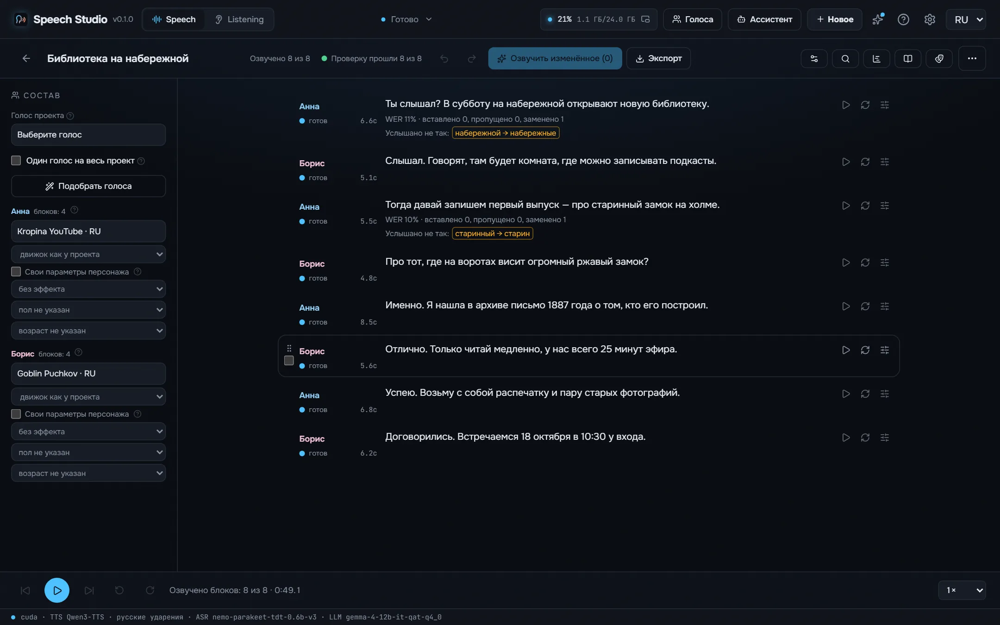
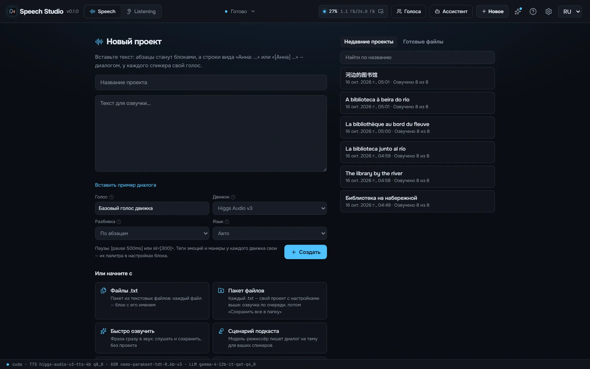
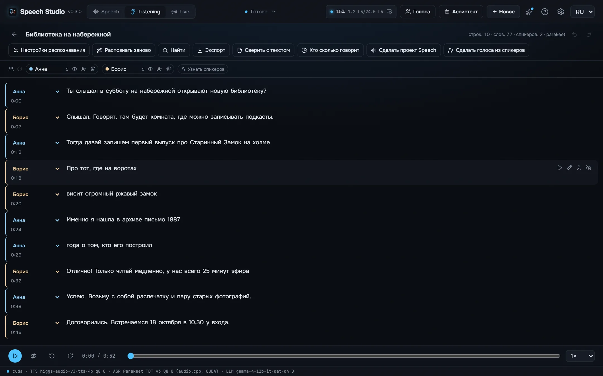
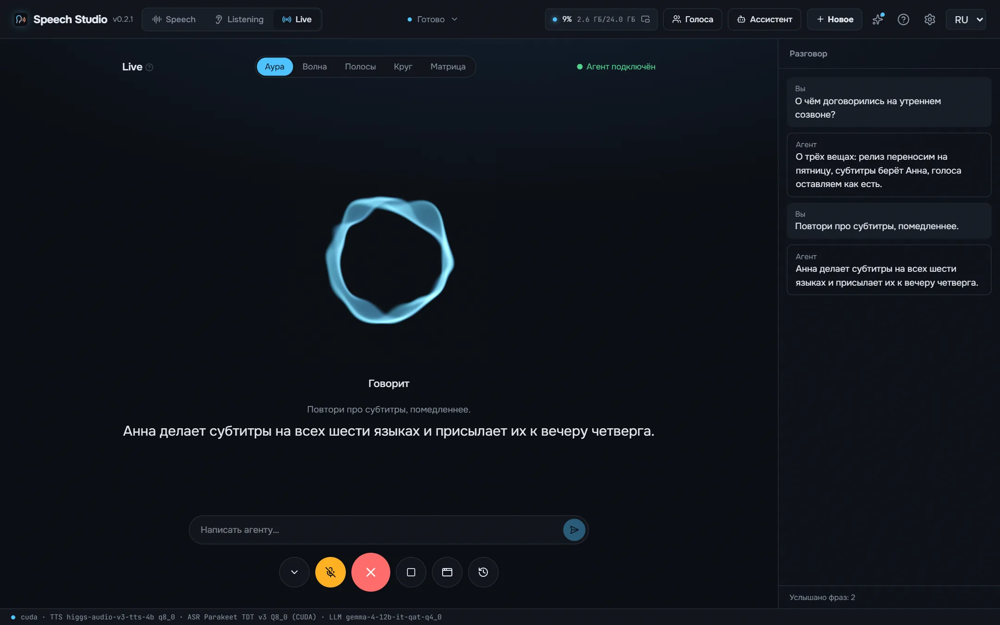

<div align="center">


# Speech Studio

**Бесплатная офлайн-студия ИИ-голоса для Windows, macOS (Apple silicon) и Linux — озвучивает любой текст клонированными и встроенными голосами и превращает записи в текст со спикерами. Русский как надо: числа в падежах, ударения, «ё» и омографы. 100% локально, ноль Python: одна нативная программа (Rust + C++ на CUDA, Vulkan или Metal); каждая модель и каждый движок скачиваются кнопкой.**

[](LICENSE)
[](https://github.com/timoncool/speech-studio/stargazers)
[](https://github.com/timoncool/speech-studio/releases)
[](https://github.com/timoncool/speech-studio/releases)
[](https://github.com/timoncool/speech-studio/commits)

[English](README.md) · **Русский** · [中文](README.zh.md) · [Español](README.es.md) · [Português](README.pt.md) · [Français](README.fr.md)



</div>

## Что это

У **Speech Studio** три режима. **Speech** озвучивает текст: фразу, диалог с голосом на каждого персонажа, подкаст, который пишет режиссёр, или целую книгу из EPUB, FB2, PDF или DOCX. **Listening** превращает запись, видео или ссылку в текст с тем, кто что сказал и когда, монтирует её по словам, проверяет озвучку против текста, который должен звучать, и делает голоса библиотеки из её спикеров. **Live** — разговор голосом с ИИ-агентом, подключённым по MCP: он произносит каждую фразу, как только её написал, и слышит вас через микрофон.

Всё работает **локально на вашем компьютере** — без облака и подписки; тексты, записи и слепки голоса не покидают компьютер. Если нужен голос, который не тянет видеокарта, есть облачные голоса **OpenRouter**, **Google Gemini**, **fal.ai** и **Runware** — у каждого свой ключ и подтверждение перед первым вызовом; по умолчанию они выключены.

Это **полностью нативная программа**: ни встроенного Python, ни torch, ни CUDA-колёс. Вся студия — **Rust + нативные движки C++ (GGUF/ONNX) на CUDA, Vulkan или Metal**. Модели, движки, библиотеки CUDA и VC++ и ffmpeg **программа скачивает сама** при первом запуске, а модель, которая уже есть у другой студии автора, берёт у неё, а не качает заново. **Программа сделана и проверена под видеокарты NVIDIA**; остальное — в разделе *Что где работает*.

## Для ИИ-агентов

Пока Speech Studio открыта, она отдаёт MCP на `http://127.0.0.1:8797/mcp`: агент вроде Claude Code, Claude Desktop, Cursor или Codex делает всё, что умеет окно, тем же кодом — озвучивает текст в файл одним вызовом, создаёт и правит проекты по блокам, раздаёт голоса персонажам, создаёт голос по описанию, распознаёт и проверяет записи, экспортирует аудиокниги с главами и субтитрами. В настройках, раздел **Агент (MCP)**, видно, подключён ли агент и что вставить в клиент. Одного агент не может: включить микрофон. Live, запись и проверка микрофона начинаются только по вашему нажатию или клавише.

1. Установите студию из [последнего релиза](https://github.com/timoncool/speech-studio/releases/latest) и запустите.
2. Подключитесь к её MCP-серверу:
   ```bash
   claude mcp add --transport http speech-studio http://127.0.0.1:8797/mcp
   ```
   Другие клиенты: `{ "mcpServers": { "speech-studio": { "type": "streamable-http", "url": "http://127.0.0.1:8797/mcp" } } }`
3. Прочитайте навык, который отдаёт сервер (ресурс `studio://skill`), — тот же текст, что [docs/mcp-skill.md](docs/mcp-skill.md), и начните с тула `studio_status`.

На том же порту студия говорит и на аудио-API OpenAI — `POST /v1/audio/speech`, `POST /v1/audio/transcriptions`, `GET /v1/models`, — так что программы, написанные под OpenAI, озвучивают и распознают через неё, а `voice` — имя голоса из библиотеки. [llms.txt](llms.txt) говорит то же для инструментов, которые его ищут. Подключаться могут только программы этого компьютера.

## Что с ней можно сделать

- **Аудиокнигу** — бросьте EPUB или FB2: главы, персонажи со своими голосами, M4B с главами и обложкой, проверка громкости ACX.
- **Подкаст или диалог** — режиссёр пишет подкаст на тему для двух-трёх спикеров, или вставьте строки «Анна: …»; таймлайн показывает каждое наложение.
- **Закадровую озвучку видео** — озвучьте сценарий или субтитры точно в их тайминги, подложите музыку и звуки в трековом редакторе, выгрузите в громкости для видео.
- **Расшифровку интервью или лекции** — кто что сказал и когда, время каждого слова, субтитры по правилам вещателей, монтаж записи по тексту.
- **Проверку дубляжа** — наложите сценарий на запись и увидите каждое слово, сказанное неверно или пропущенное.
- **Свою библиотеку голосов** — запишите или импортируйте голоса, очистите их, сделайте голоса из спикеров записи.
- **Голос для своего ИИ-агента** — разговаривайте с Claude Code или любым агентом по MCP в Live или поручите ему озвучивать и распознавать файлы через MCP или OpenAI-совместимый API.

Примеры всех движков и голосов, русские ударения до и после — на [странице проекта](https://timoncool.github.io/speech-studio/ru.html).

## Три режима

| Режим | Что делает |
|------|--------------|
| 🔊 **Speech** | Текст, диалог, подкаст или книга → озвученные блоки с дублями, проверка на слух, экспорт в WAV, FLAC, MP3, OGG, M4A или M4B с главами, субтитрами и текстом с таймингами |
| 👂 **Listening** | Аудио, видео или ссылка → транскрипт со спикерами и временем слов, плеер-караоке, монтаж по тексту, экспорт в SRT, VTT, ASS, TXT или JSON, сверка с эталонным текстом |
| 🎙️ **Live** | Голосовой разговор с ИИ-агентом: агент, подключённый по MCP, произносит каждую фразу, как только её написал, вы отвечаете в микрофон и распознаётесь пофразно, фраза поверх агента его останавливает; микрофон включаете только вы, пауза — M или Ctrl+Shift+Пробел, виджет поверх всех окон |

## Возможности

**Голоса и движки**

- **Пять локальных движков** — [Higgs Audio v3](https://huggingface.co/bosonai) (клонирование, эмоции и звуки), **Fish Audio Drama 3** (самый сильный открытый голос; целиком на видеокарте 24 ГБ, с 6 ГБ — эксперты в оперативной памяти), **Supertonic 3** (быстрый, десять встроенных голосов), **Qwen3-TTS 1.7B** (девять встроенных голосов, клонирование, указание на каждый блок) и **Qwen3-TTS с русскими ударениями** — LoRA siriusfreak, подключаемая на лету.
- **Свой движок у персонажа и у блока** поверх движка проекта; движок, который не может говорить выбранным голосом, говорит, какой из своих голосов возьмёт.
- **Библиотека голосов** — войспак одной кнопкой, 743 русских голоса из облачного каталога, запись с микрофона, импорт файлов и ZIP, фото, пол, возраст, язык, теги и согласие; текст рефа распознаётся один раз и хранится.
- **Очистка рефа** — Mel-Band Roformer отделяет голос от музыки, **DPDFNet** убирает шум с регулятором силы, чтобы речь осталась живой; исходник сохраняется.
- **Лучший кусок рефа** — окна по паузам между распознанными словами, у каждого длина, сигнал/шум, клиппинг и самая длинная пауза.
- **Голос по описанию** — Qwen3-TTS VoiceDesign создаёт голос по «пожилая женщина с мягким, чуть хрипловатым голосом…»: послушайте несколько кандидатов и сохраните лучший в библиотеку.

- **Облачные голоса** — OpenRouter, Google Gemini (параллельные запросы или Batch за полцены), fal.ai и Runware, у каждого свой ключ и подтверждение перед первым запросом.

**Текст, который звучит правильно**

- **Нормализатор русского** — числа в нужном падеже и роде, даты, время, деньги, единицы, римские цифры, латинские бренды и аббревиатуры.
- **Ударения, «ё» и омографы** через RUAccent — большая модель омографов (big_poetry в int8, те же решения, что у fp32) выбирает «замо́к» или «за́мок» по предложению; спорные подсвечиваются, ваши `+` не трогаются.
- **Словарь произношения** — замена, regex и фонемы, со скоупом проекта, языка, голоса или движка, импорт словарей Balabolka `.rex`/`.dic`/`.bxd` и проверка правила на слух прямо из словаря.
- **Разметка в стиле SpeechKit** — ударение `+`, паузы `sil<[300]>` и `[pause 500ms]`, темп `[rate:1.2]`, `**акцент**`; что движок не понимает — помечается, а не пропадает молча.

- **Ещё больше текста читается верно** — подмножество SSML, подсказки просодии цветом по словам, телефоны, почта и коды, отрывок на другом языке тем же голосом и проверка сценария перед озвучкой.

**Проекты**

- **Текст как таймлайн** — блоки со спикерами, дубли (до пяти), отслеживание устаревших, отмена и повтор, перетаскивание, поиск и замена с regex, заметки и маркеры.
- **Контроль качества** — каждый дубль распознаётся обратно и сравнивается по словам, плюс проверки клиппинга, тишины, обрыва, щелчка в конце, повтора фразы, длинного хвоста, музыки или шума вместо речи и похожести на голос рефа; несколько дублей с выбором лучшего.
- **Диалоги и подкасты** — строки `Анна:` и `[Анна]` становятся персонажами, режиссёр пишет подкаст на тему для N спикеров, отрицательные паузы дают перебивания, а **шкала** показывает каждое перекрытие с решениями «обрезать», «склеить» или «оставить».
- **Аудиокниги** — EPUB, FB2, PDF, DOCX, HTML, Markdown и TXT с предпросмотром глав, разметка по персонажам режиссёром, M4B с главами и обложкой, деление длинных книг на части, проверка громкости ACX.
- **Субтитры как проект** — строки SRT, VTT и ASS озвучиваются в свои реплики: темп повышается заранее, не влезший дубль переозвучивается, дальше ускорение и заём тишины перед репликой.
- **Проверка перед экспортом** — блоки без звука, устаревшие, упавшие, с изменённым файлом или длиннее реплики перечисляются до экспорта; разрешить можно только расхождение длительности.
- **Громкость** — пресеты «видео» (−14 LUFS), «подкаст» (−16 LUFS) и ACX с true-peak лимитером, room tone и вдохи между блоками.
- **Файл проекта** — `.speechproj` с текстом, голосами и звуком переносит проект на другой компьютер.

- **Монтаж** — трековый редактор под текстом: сдвиг, подрезка, фейды и громкость каждого клипа, дорожки музыки и звуков из файлов или папок либо песня, сделанная тут же в YuE2, MiniMax Music3 или ACE-Step Studio.
- **Экспорт под любую задачу** — файл на главу, дорожка на персонажа в ZIP, таблица реплик CSV, эффекты голоса (рация, телефон, громкоговоритель), ровная громкость кусков, частота и разрядность, шаблоны имён файлов, манифест SHA-256 и записка о том, как сделано.
- **Сравнить и утвердить** — A/B дублей, слепое сравнение движков на одном тексте, утверждённые блоки, которые переозвучка не трогает, светофор качества и отчёт по проекту.
- **Книги и спектакли** — прямая речь отдельно от авторской, реестр персонажей с подобранными голосами, чистка сносок, имена книги в словарь, обновление проекта из исправленной книги без потери озвученного и HTML-плеер книги.

**Listening**

- **Parakeet-TDT и Nemotron 3.5 (28 языков с пунктуацией) на transcribe.cpp или CrisperWhisper 2.0 turbo (99 языков со временем слов) на audio.cpp**, до восьми спикеров через Nemotron 3 Diarization, длинная запись режется по паузам **Silero VAD v6**, шум убирает DPDFNet, музыку — Roformer.
- **Подсказка для CrisperWhisper** — тема и написания терминов, плюс ваши исправления.
- **Пакет** — бросьте несколько файлов сразу: каждый станет записью в очереди распознавания.
- **Текст поверх записи** — эталонный текст получает время каждого услышанного слова, предложение за предложением.
- **Голоса из спикеров** — голос библиотеки из самых чистых слов каждого спикера.

- **На ходу** — распознавание с микрофона пофразно, папка записей в фоне, быстрое распознавание без редактора.
- **Нужная модель сама** — при языке «Авто» его определяет VoxLingua107, и запись уходит распознавателю, который этот язык знает; выбранная модель скачивается при первом использовании.
- **Субтитры по правилам вещателей** (Netflix, BBC и другие), «Кто сколько говорит», числа цифрами в экспорте.

**Live**

- **Разговор голосом** — агент, подключённый по MCP, произносит каждую фразу, как только её написал; вы отвечаете в микрофон и распознаётесь пофразно; фраза хотя бы из двух слов поверх агента его останавливает, а кашель, смех или «угу» — нет; набранная строка доходит до агента как сказанная.
- **Смена на ходу** — голос агента, распознаватель, язык и микрофон меняются посреди разговора — вами или агентом по вашей просьбе: распознаватель переключается на месте, новый микрофон или язык перезапускают микрофон, а пока грузится движок нового голоса, окно пишет «Загружаю голос…».
- **Естественный темп** — фраза агента говорится целиком до 300 знаков, пауза, которую движок оставил внутри фразы, звучит не дольше 0,6 с, и каждая фраза звучит один раз.
- **Микрофон включаете только вы** — Live, запись в Listening, запись голоса и проверка микрофона начинаются только по вашему нажатию или клавише; у агента нет инструмента, который включает микрофон, и окно не принимает его нажатия на эти кнопки. Вверху видно «Микрофон включён», для чего и сколько времени, с крестиком, который его выключает; если окна студии нет пять секунд, микрофон выключается сам.
- **Микрофон и звук** — пауза клавишей M или Ctrl+Shift+Пробел из любого окна (агент замолкает и не слышит вас; держать — говорить), крестик завершает разговор и обрывает речь агента, индикаторы уровня, «Прослушать себя», проверка динамика и громкость агента.
- **Пять видов и виджет** — аура, волна, полосы, круг и матрица и маленький виджет поверх всех окон; Ctrl+3 открывает Live.
- **Замерено** — ваша фраза становится текстом через 0,64–0,74 с после того, как вы замолчали (Parakeet на RTX 4090), а первый звук ответа приходит через 15 мс – 1 с после того, как агент его написал, в зависимости от движка.

**Везде**

- **API, совместимый с OpenAI**, **MCP** с управлением окном для агентов, панель ассистента на модели OpenRouter с теми же тулами.
- **Диагностика** — видеокарта, драйвер, CUDA, библиотеки, логи, пакет для баг-репорта без ключей.
- **Вся программа на шести языках**, светлая и тёмная тема, автообновление, полностью портативна.
- **Первый запуск спрашивает только, что вам нужно** — голоса, распознавание и дополнения; движки, библиотеки и сборка под вашу видеокарту приходят вместе с выбранным, одной строкой с размером.
- **Палитра команд** (Ctrl+K), свои горячие клавиши, простой режим и подсказка «?» у каждого элемента.

## Замеры скорости

На одном компьютере: RTX 4090 (24 ГБ) под Windows 11, Speech Studio как она ставится.

**Озвучка** — Speech Studio 0.2.0, один и тот же русский текст на 17 секунд, второй прогон каждого движка (модель загружена); Higgs — в движке audio.cpp 22.10, три прогона, первый звук не замерен; первый звук — время до начала звука в окне, видеопамять — пик во время озвучки.

| Движок | Быстрее реального времени | Первый звук | Поток | Скачать | Видеопамять |
|---|---|---|---|---|---|
| Supertonic 3 | 168× | 103 мс | по фразам | 0,1 ГБ | 1,0 ГБ |
| Qwen3-TTS | 12× | 19 мс | по ходу речи | 2,2 ГБ | 3,1 ГБ |
| Qwen3-TTS + ru stress LoRA | 10× | 26 мс | по ходу речи | 2,3 ГБ | 3,5 ГБ |
| Fish Audio Drama 3 | 7,0× | 326 мс | по ходу речи | 21,4 ГБ | 21,9 ГБ |
| Higgs Audio v3 | 3,4× | — | по ходу речи | 5,3 ГБ | ~7 ГБ |

**Распознавание** — Speech Studio 0.2.1 (CrisperWhisper — движок audio.cpp 22.10: русская запись на 625,8 с, с загрузкой движка; на процессоре и видеопамять не замерены), одна русская запись одного говорящего на 5 минут (299,7 с) в Listening без разделения по говорящим, загрузка модели входит; после задачи модель освобождает видеопамять.

| Модель | На видеокарте | На процессоре | Языки | Скачать | Видеопамять |
|---|---|---|---|---|---|
| Parakeet TDT v3 | 96× (3,1 с) | 33× (9,2 с) | 25 | 0,7 ГБ | 1,2 ГБ |
| Parakeet Ultra | 73× (4,1 с) | 33× (9,2 с) | 25 | 0,7 ГБ | 1,0 ГБ |
| Nemotron 3.5 | 73× (4,1 с) | 29× (10,3 с) | 28 | 0,7 ГБ | 1,0 ГБ |
| CrisperWhisper 2.0 turbo | 96× (6,5 с) | — | 99 | 1,6 ГБ | — |

**Live** — один ход разговора.

| Шаг | Время |
|---|---|
| Ваша фраза текстом после того, как вы замолчали (Parakeet на видеокарте, пауза конца фразы входит) | 0,64–0,74 с |
| Агент пишет ответ (Claude Sonnet) | 2,0–3,9 с |
| Первый звук ответа (по движкам, см. «Озвучка») | 15 мс – 1,0 с |

## Скриншоты

Стартовый экран — текст, книга, субтитры или сценарий подкаста становятся проектом:



Listening — транскрипт со спикерами и временем слов, плеер-караоке, монтаж по тексту и экспорт:



Live — голосовой разговор с ИИ-агентом: что вы сказали и что он ответил, пять видов, пауза и завершение разговора:



## Требования

- **ОС:** Windows 10 / 11 (x64); macOS 13 и новее на Apple silicon и Linux x86-64 — экспериментальные сборки
- **Видеокарта:** NVIDIA с 8 ГБ видеопамяти или больше. Карты от Turing (GTX 16, RTX 20 и новее) с драйвером 580 и новее идут на сборках CUDA 13; GTX 900, GTX 10, Volta и драйверы 525–579 — на сборках CUDA 12 у Higgs, Supertonic, CrisperWhisper, разделения говорящих, Qwen3-TTS, сепарации и режиссёра, а распознавание у них идёт через Vulkan. Drama 3 нужна CUDA 13: целиком она помещается в 24 ГБ; с 6 ГБ её эксперты (18 ГБ) живут в оперативной памяти, и тогда её нужно 32 ГБ, а сколько видеопамяти брать, задаётся в настройках («Авто» или от 5 до 24 ГБ). Карта AMD или Intel идёт на сборках Vulkan, компьютер без видеокарты — на сборках для процессора, Mac — на Metal (без Drama 3); эти конфигурации автор не проверял
- **WebView2** — уже есть в Windows 11; на Windows 10 установщик скачает его сам
- **Диск:** около 9 ГБ под модели, движки и библиотеки по умолчанию, плюс то, что добавите (Drama 3 — 23 ГБ)

На машине с NVIDIA руками ставится только свежий **[драйвер NVIDIA](https://www.nvidia.com/Download/index.aspx)**.

## Быстрый старт

1. **Скачайте** из [последнего релиза](https://github.com/timoncool/speech-studio/releases/latest): для Windows — портативную `Speech-Studio-<версия>-portable-windows-x64.zip` (распакуйте куда угодно) или установщик `Speech.Studio_<версия>_x64-setup.exe`; для macOS — `Speech-Studio-<версия>-macos-arm64.dmg`; для Linux — `Speech-Studio-<версия>-linux-x86_64-experimental.AppImage` или `Speech-Studio-<версия>-linux-amd64-experimental.deb`.
2. **Запустите** `Speech Studio.exe` (Windows), Speech Studio из «Программ» (macOS) или AppImage (Linux).
3. На панели **Первый запуск** нажмите **Скачать отмеченное** — программа один раз скачает модели, движки и библиотеки.
4. **Вставьте текст** и нажмите **Создать** или переключитесь в **Listening** и бросьте запись.

> На Windows всё скачивается и живёт **внутри папки программы**: модели, кэши, голоса и проекты больше никуда не попадают. На Linux всё лежит в `~/.local/share/speech-studio`, на macOS — в `~/Library/Application Support/Speech Studio`.

Что и когда изменилось — в [CHANGELOG.md](CHANGELOG.md), а кнопка с искрами вверху программы показывает это в окне. Правила для участников и агентов-разработчиков — [AGENTS.md](AGENTS.md).

## Всё, что скачивает программа

Панель первого запуска скачивает всё это кнопкой. За прокси или там, где закрыт Hugging Face, укажите прокси в «Настройки → **Сеть**». Можно и скачать прямые файлы самому, положить их туда, куда говорит последний столбец (от папки программы), и нажать **Указать готовую папку**; архивные компоненты программа скачивает сама. Каждый файл перед использованием сверяется с закреплённым SHA-256. Размеры и хэши — из манифеста программы `crates/speech-server/src/setup.rs` и закреплённых версий общих крейтов, которые он называет, и эта таблица сверяется с ними. В таблице файлы для Windows: карта NVIDIA, на которой идёт CUDA 13, берёт сборки CUDA 13, старая карта NVIDIA или старый драйвер — сборки CUDA 12.9, карта AMD или Intel — сборки Vulkan, компьютер без видеокарты — сборки для процессора; стадия, которой в «Настройки → Модели» выбрано другое устройство, берёт сборку этого устройства. На Linux и macOS программа скачивает сборки тех же компонентов для своей системы.

<!-- downloads:start -->
| Компонент | Нужен | Файлы (прямые ссылки) | Размер | Куда положить |
|---|---|---|---|---|
| Higgs Audio v3 Q8_0 | обязателен | [q8_0.gguf](https://huggingface.co/drbaph/Higgs-Audio-v3-Studio/resolve/c6e9db5a2062c15accc1b9bfa54d927bbdb124dc/models/higgs-q8_0/q8_0.gguf) → `models\higgs-q8_0\q8_0.gguf`<br>[config.json](https://huggingface.co/drbaph/Higgs-Audio-v3-Studio/resolve/c6e9db5a2062c15accc1b9bfa54d927bbdb124dc/models/higgs-q8_0/config.json) → `models\higgs-q8_0\config.json`<br>[chat_template.jinja](https://huggingface.co/drbaph/Higgs-Audio-v3-Studio/resolve/c6e9db5a2062c15accc1b9bfa54d927bbdb124dc/models/higgs-q8_0/chat_template.jinja) → `models\higgs-q8_0\chat_template.jinja`<br>[tokenizer.json](https://huggingface.co/drbaph/Higgs-Audio-v3-Studio/resolve/c6e9db5a2062c15accc1b9bfa54d927bbdb124dc/models/higgs-q8_0/tokenizer.json) → `models\higgs-q8_0\tokenizer.json`<br>[tokenizer_config.json](https://huggingface.co/drbaph/Higgs-Audio-v3-Studio/resolve/c6e9db5a2062c15accc1b9bfa54d927bbdb124dc/models/higgs-q8_0/tokenizer_config.json) → `models\higgs-q8_0\tokenizer_config.json`<br>[higgs_audio_v2_tokenizer_config.json](https://huggingface.co/drbaph/Higgs-Audio-v3-Studio/resolve/c6e9db5a2062c15accc1b9bfa54d927bbdb124dc/models/higgs-q8_0/higgs_audio_v2_tokenizer_config.json) → `models\higgs-q8_0\higgs_audio_v2_tokenizer_config.json` | 5.5 GB | как есть, по пути после стрелки |
| audio.cpp server, CUDA 13 (Higgs, Supertonic, CrisperWhisper, diarization) | обязателен | [audiocpp-server-win-cuda13-x64.zip](https://github.com/timoncool/audio.cpp/releases/download/server-6d6cb6a5/audiocpp-server-win-cuda13-x64.zip) | 131 MB | распаковать файлы без подпапок в `tools\audiocpp\` |
| Gemma-4 12B QAT q4_0 + vision | по желанию | [gemma-4-12b-it-qat-q4_0.gguf](https://huggingface.co/google/gemma-4-12b-it-qat-q4_0-gguf/resolve/2b318d6ebebf093f50ca4376e858325f10703358/gemma-4-12b-it-qat-q4_0.gguf) → `models\mt\gemma-4-12b-it-qat-q4_0.gguf`<br>[mmproj-gemma-4-12b-it-qat-q4_0.gguf](https://huggingface.co/google/gemma-4-12b-it-qat-q4_0-gguf/resolve/2b318d6ebebf093f50ca4376e858325f10703358/mmproj-gemma-4-12b-it-qat-q4_0.gguf) → `models\mt\mmproj-gemma-4-12b-it-qat-q4_0.gguf` | 7.2 GB | как есть, по пути после стрелки |
| Gemma-4 12B Q5_K_M + vision | по желанию | [gemma-4-12b-it-Q5_K_M.gguf](https://huggingface.co/unsloth/gemma-4-12b-it-GGUF/resolve/d997c805aafe035a8024f961c6e1afd6b30d79a5/gemma-4-12b-it-Q5_K_M.gguf) → `models\mt-q5_0\gemma-4-12b-it-Q5_K_M.gguf`<br>[mmproj-F16.gguf](https://huggingface.co/unsloth/gemma-4-12b-it-GGUF/resolve/d997c805aafe035a8024f961c6e1afd6b30d79a5/mmproj-F16.gguf) → `models\mt-q5_0\mmproj-F16.gguf` | 8.6 GB | как есть, по пути после стрелки |
| Gemma-4 12B Q6_K + vision | по желанию | [gemma-4-12b-it-Q6_K.gguf](https://huggingface.co/unsloth/gemma-4-12b-it-GGUF/resolve/d997c805aafe035a8024f961c6e1afd6b30d79a5/gemma-4-12b-it-Q6_K.gguf) → `models\mt-q6_k\gemma-4-12b-it-Q6_K.gguf`<br>[mmproj-F16.gguf](https://huggingface.co/unsloth/gemma-4-12b-it-GGUF/resolve/d997c805aafe035a8024f961c6e1afd6b30d79a5/mmproj-F16.gguf) → `models\mt-q6_k\mmproj-F16.gguf` | 10.0 GB | как есть, по пути после стрелки |
| Gemma-4 12B Q8_0 + vision | по желанию | [gemma-4-12b-it-Q8_0.gguf](https://huggingface.co/unsloth/gemma-4-12b-it-GGUF/resolve/d997c805aafe035a8024f961c6e1afd6b30d79a5/gemma-4-12b-it-Q8_0.gguf) → `models\mt-q8_0\gemma-4-12b-it-Q8_0.gguf`<br>[mmproj-F16.gguf](https://huggingface.co/unsloth/gemma-4-12b-it-GGUF/resolve/d997c805aafe035a8024f961c6e1afd6b30d79a5/mmproj-F16.gguf) → `models\mt-q8_0\mmproj-F16.gguf` | 12.8 GB | как есть, по пути после стрелки |
| Parakeet-TDT 0.6B v3 Q8_0 (transcribe.cpp) | обязателен | [parakeet-tdt-0.6b-v3-Q8_0.gguf](https://huggingface.co/handy-computer/parakeet-tdt-0.6b-v3-gguf/resolve/d8d8c32cb2017c57e5307767343e97870f8a7f53/parakeet-tdt-0.6b-v3-Q8_0.gguf) → `models\asr-gguf-parakeet-v3\parakeet-tdt-0.6b-v3-Q8_0.gguf` | 740 MB | как есть, по пути после стрелки |
| Higgs Audio v3 Q6_K | по желанию | [q6_k.gguf](https://huggingface.co/drbaph/Higgs-Audio-v3-Studio/resolve/c6e9db5a2062c15accc1b9bfa54d927bbdb124dc/models/higgs-q6_k/q6_k.gguf) → `models\higgs-q6_k\q6_k.gguf`<br>[config.json](https://huggingface.co/drbaph/Higgs-Audio-v3-Studio/resolve/c6e9db5a2062c15accc1b9bfa54d927bbdb124dc/models/higgs-q6_k/config.json) → `models\higgs-q6_k\config.json`<br>[chat_template.jinja](https://huggingface.co/drbaph/Higgs-Audio-v3-Studio/resolve/c6e9db5a2062c15accc1b9bfa54d927bbdb124dc/models/higgs-q6_k/chat_template.jinja) → `models\higgs-q6_k\chat_template.jinja`<br>[tokenizer.json](https://huggingface.co/drbaph/Higgs-Audio-v3-Studio/resolve/c6e9db5a2062c15accc1b9bfa54d927bbdb124dc/models/higgs-q6_k/tokenizer.json) → `models\higgs-q6_k\tokenizer.json`<br>[tokenizer_config.json](https://huggingface.co/drbaph/Higgs-Audio-v3-Studio/resolve/c6e9db5a2062c15accc1b9bfa54d927bbdb124dc/models/higgs-q6_k/tokenizer_config.json) → `models\higgs-q6_k\tokenizer_config.json`<br>[higgs_audio_v2_tokenizer_config.json](https://huggingface.co/drbaph/Higgs-Audio-v3-Studio/resolve/c6e9db5a2062c15accc1b9bfa54d927bbdb124dc/models/higgs-q6_k/higgs_audio_v2_tokenizer_config.json) → `models\higgs-q6_k\higgs_audio_v2_tokenizer_config.json` | 5.0 GB | как есть, по пути после стрелки |
| Higgs Audio v3 Q4_K_M | по желанию | [q4_k_m.gguf](https://huggingface.co/drbaph/Higgs-Audio-v3-Studio/resolve/c6e9db5a2062c15accc1b9bfa54d927bbdb124dc/models/higgs-q4_k_m/q4_k_m.gguf) → `models\higgs-q4_k_m\q4_k_m.gguf`<br>[config.json](https://huggingface.co/drbaph/Higgs-Audio-v3-Studio/resolve/c6e9db5a2062c15accc1b9bfa54d927bbdb124dc/models/higgs-q4_k_m/config.json) → `models\higgs-q4_k_m\config.json`<br>[chat_template.jinja](https://huggingface.co/drbaph/Higgs-Audio-v3-Studio/resolve/c6e9db5a2062c15accc1b9bfa54d927bbdb124dc/models/higgs-q4_k_m/chat_template.jinja) → `models\higgs-q4_k_m\chat_template.jinja`<br>[tokenizer.json](https://huggingface.co/drbaph/Higgs-Audio-v3-Studio/resolve/c6e9db5a2062c15accc1b9bfa54d927bbdb124dc/models/higgs-q4_k_m/tokenizer.json) → `models\higgs-q4_k_m\tokenizer.json`<br>[tokenizer_config.json](https://huggingface.co/drbaph/Higgs-Audio-v3-Studio/resolve/c6e9db5a2062c15accc1b9bfa54d927bbdb124dc/models/higgs-q4_k_m/tokenizer_config.json) → `models\higgs-q4_k_m\tokenizer_config.json`<br>[higgs_audio_v2_tokenizer_config.json](https://huggingface.co/drbaph/Higgs-Audio-v3-Studio/resolve/c6e9db5a2062c15accc1b9bfa54d927bbdb124dc/models/higgs-q4_k_m/higgs_audio_v2_tokenizer_config.json) → `models\higgs-q4_k_m\higgs_audio_v2_tokenizer_config.json` | 4.1 GB | как есть, по пути после стрелки |
| Fish Audio Drama 3 Q4 + drama_engine (6 GB+ GPU, 32 GB RAM under 24 GB) | по желанию | [.gitattributes](https://huggingface.co/apiplant/drama-q4/resolve/1fce9bd21d46a0311294aebfad19f994df90902f/.gitattributes) → `models\drama3\.gitattributes`<br>[LICENSE](https://huggingface.co/apiplant/drama-q4/resolve/1fce9bd21d46a0311294aebfad19f994df90902f/LICENSE) → `models\drama3\LICENSE`<br>[NOTICE](https://huggingface.co/apiplant/drama-q4/resolve/1fce9bd21d46a0311294aebfad19f994df90902f/NOTICE) → `models\drama3\NOTICE`<br>[README.md](https://huggingface.co/apiplant/drama-q4/resolve/1fce9bd21d46a0311294aebfad19f994df90902f/README.md) → `models\drama3\README.md`<br>[codec.safetensors](https://huggingface.co/apiplant/drama-q4/resolve/1fce9bd21d46a0311294aebfad19f994df90902f/codec.safetensors) → `models\drama3\codec.safetensors`<br>[drama.json](https://huggingface.co/apiplant/drama-q4/resolve/1fce9bd21d46a0311294aebfad19f994df90902f/drama.json) → `models\drama3\drama.json`<br>[globals.safetensors](https://huggingface.co/apiplant/drama-q4/resolve/1fce9bd21d46a0311294aebfad19f994df90902f/globals.safetensors) → `models\drama3\globals.safetensors`<br>[layer00.safetensors](https://huggingface.co/apiplant/drama-q4/resolve/1fce9bd21d46a0311294aebfad19f994df90902f/layer00.safetensors) → `models\drama3\layer00.safetensors`<br>[layer01.safetensors](https://huggingface.co/apiplant/drama-q4/resolve/1fce9bd21d46a0311294aebfad19f994df90902f/layer01.safetensors) → `models\drama3\layer01.safetensors`<br>[layer02.safetensors](https://huggingface.co/apiplant/drama-q4/resolve/1fce9bd21d46a0311294aebfad19f994df90902f/layer02.safetensors) → `models\drama3\layer02.safetensors`<br>[layer03.safetensors](https://huggingface.co/apiplant/drama-q4/resolve/1fce9bd21d46a0311294aebfad19f994df90902f/layer03.safetensors) → `models\drama3\layer03.safetensors`<br>[layer04.safetensors](https://huggingface.co/apiplant/drama-q4/resolve/1fce9bd21d46a0311294aebfad19f994df90902f/layer04.safetensors) → `models\drama3\layer04.safetensors`<br>[layer05.safetensors](https://huggingface.co/apiplant/drama-q4/resolve/1fce9bd21d46a0311294aebfad19f994df90902f/layer05.safetensors) → `models\drama3\layer05.safetensors`<br>[layer06.safetensors](https://huggingface.co/apiplant/drama-q4/resolve/1fce9bd21d46a0311294aebfad19f994df90902f/layer06.safetensors) → `models\drama3\layer06.safetensors`<br>[layer07.safetensors](https://huggingface.co/apiplant/drama-q4/resolve/1fce9bd21d46a0311294aebfad19f994df90902f/layer07.safetensors) → `models\drama3\layer07.safetensors`<br>[layer08.safetensors](https://huggingface.co/apiplant/drama-q4/resolve/1fce9bd21d46a0311294aebfad19f994df90902f/layer08.safetensors) → `models\drama3\layer08.safetensors`<br>[layer09.safetensors](https://huggingface.co/apiplant/drama-q4/resolve/1fce9bd21d46a0311294aebfad19f994df90902f/layer09.safetensors) → `models\drama3\layer09.safetensors`<br>[layer10.safetensors](https://huggingface.co/apiplant/drama-q4/resolve/1fce9bd21d46a0311294aebfad19f994df90902f/layer10.safetensors) → `models\drama3\layer10.safetensors`<br>[layer11.safetensors](https://huggingface.co/apiplant/drama-q4/resolve/1fce9bd21d46a0311294aebfad19f994df90902f/layer11.safetensors) → `models\drama3\layer11.safetensors`<br>[layer12.safetensors](https://huggingface.co/apiplant/drama-q4/resolve/1fce9bd21d46a0311294aebfad19f994df90902f/layer12.safetensors) → `models\drama3\layer12.safetensors`<br>[layer13.safetensors](https://huggingface.co/apiplant/drama-q4/resolve/1fce9bd21d46a0311294aebfad19f994df90902f/layer13.safetensors) → `models\drama3\layer13.safetensors`<br>[layer14.safetensors](https://huggingface.co/apiplant/drama-q4/resolve/1fce9bd21d46a0311294aebfad19f994df90902f/layer14.safetensors) → `models\drama3\layer14.safetensors`<br>[layer15.safetensors](https://huggingface.co/apiplant/drama-q4/resolve/1fce9bd21d46a0311294aebfad19f994df90902f/layer15.safetensors) → `models\drama3\layer15.safetensors`<br>[layer16.safetensors](https://huggingface.co/apiplant/drama-q4/resolve/1fce9bd21d46a0311294aebfad19f994df90902f/layer16.safetensors) → `models\drama3\layer16.safetensors`<br>[layer17.safetensors](https://huggingface.co/apiplant/drama-q4/resolve/1fce9bd21d46a0311294aebfad19f994df90902f/layer17.safetensors) → `models\drama3\layer17.safetensors`<br>[layer18.safetensors](https://huggingface.co/apiplant/drama-q4/resolve/1fce9bd21d46a0311294aebfad19f994df90902f/layer18.safetensors) → `models\drama3\layer18.safetensors`<br>[layer19.safetensors](https://huggingface.co/apiplant/drama-q4/resolve/1fce9bd21d46a0311294aebfad19f994df90902f/layer19.safetensors) → `models\drama3\layer19.safetensors`<br>[layer20.safetensors](https://huggingface.co/apiplant/drama-q4/resolve/1fce9bd21d46a0311294aebfad19f994df90902f/layer20.safetensors) → `models\drama3\layer20.safetensors`<br>[layer21.safetensors](https://huggingface.co/apiplant/drama-q4/resolve/1fce9bd21d46a0311294aebfad19f994df90902f/layer21.safetensors) → `models\drama3\layer21.safetensors`<br>[layer22.safetensors](https://huggingface.co/apiplant/drama-q4/resolve/1fce9bd21d46a0311294aebfad19f994df90902f/layer22.safetensors) → `models\drama3\layer22.safetensors`<br>[layer23.safetensors](https://huggingface.co/apiplant/drama-q4/resolve/1fce9bd21d46a0311294aebfad19f994df90902f/layer23.safetensors) → `models\drama3\layer23.safetensors`<br>[layer24.safetensors](https://huggingface.co/apiplant/drama-q4/resolve/1fce9bd21d46a0311294aebfad19f994df90902f/layer24.safetensors) → `models\drama3\layer24.safetensors`<br>[layer25.safetensors](https://huggingface.co/apiplant/drama-q4/resolve/1fce9bd21d46a0311294aebfad19f994df90902f/layer25.safetensors) → `models\drama3\layer25.safetensors`<br>[layer26.safetensors](https://huggingface.co/apiplant/drama-q4/resolve/1fce9bd21d46a0311294aebfad19f994df90902f/layer26.safetensors) → `models\drama3\layer26.safetensors`<br>[layer27.safetensors](https://huggingface.co/apiplant/drama-q4/resolve/1fce9bd21d46a0311294aebfad19f994df90902f/layer27.safetensors) → `models\drama3\layer27.safetensors`<br>[layer28.safetensors](https://huggingface.co/apiplant/drama-q4/resolve/1fce9bd21d46a0311294aebfad19f994df90902f/layer28.safetensors) → `models\drama3\layer28.safetensors`<br>[layer29.safetensors](https://huggingface.co/apiplant/drama-q4/resolve/1fce9bd21d46a0311294aebfad19f994df90902f/layer29.safetensors) → `models\drama3\layer29.safetensors`<br>[layer30.safetensors](https://huggingface.co/apiplant/drama-q4/resolve/1fce9bd21d46a0311294aebfad19f994df90902f/layer30.safetensors) → `models\drama3\layer30.safetensors`<br>[layer31.safetensors](https://huggingface.co/apiplant/drama-q4/resolve/1fce9bd21d46a0311294aebfad19f994df90902f/layer31.safetensors) → `models\drama3\layer31.safetensors`<br>[layer32.safetensors](https://huggingface.co/apiplant/drama-q4/resolve/1fce9bd21d46a0311294aebfad19f994df90902f/layer32.safetensors) → `models\drama3\layer32.safetensors`<br>[layer33.safetensors](https://huggingface.co/apiplant/drama-q4/resolve/1fce9bd21d46a0311294aebfad19f994df90902f/layer33.safetensors) → `models\drama3\layer33.safetensors`<br>[layer34.safetensors](https://huggingface.co/apiplant/drama-q4/resolve/1fce9bd21d46a0311294aebfad19f994df90902f/layer34.safetensors) → `models\drama3\layer34.safetensors`<br>[layer35.safetensors](https://huggingface.co/apiplant/drama-q4/resolve/1fce9bd21d46a0311294aebfad19f994df90902f/layer35.safetensors) → `models\drama3\layer35.safetensors`<br>[layer36.safetensors](https://huggingface.co/apiplant/drama-q4/resolve/1fce9bd21d46a0311294aebfad19f994df90902f/layer36.safetensors) → `models\drama3\layer36.safetensors`<br>[layer37.safetensors](https://huggingface.co/apiplant/drama-q4/resolve/1fce9bd21d46a0311294aebfad19f994df90902f/layer37.safetensors) → `models\drama3\layer37.safetensors`<br>[layer38.safetensors](https://huggingface.co/apiplant/drama-q4/resolve/1fce9bd21d46a0311294aebfad19f994df90902f/layer38.safetensors) → `models\drama3\layer38.safetensors`<br>[layer39.safetensors](https://huggingface.co/apiplant/drama-q4/resolve/1fce9bd21d46a0311294aebfad19f994df90902f/layer39.safetensors) → `models\drama3\layer39.safetensors`<br>[tokenizer.json](https://huggingface.co/apiplant/drama-q4/resolve/1fce9bd21d46a0311294aebfad19f994df90902f/tokenizer.json) → `models\drama3\tokenizer.json`<br>[tower.safetensors](https://huggingface.co/apiplant/drama-q4/resolve/1fce9bd21d46a0311294aebfad19f994df90902f/tower.safetensors) → `models\drama3\tower.safetensors`<br>[drama_engine.dll](https://github.com/timoncool/drama-rs/releases/download/engine-0.1.3/drama_engine.dll) → `models\drama-engine\drama_engine.dll` | 23.0 GB | как есть, по пути после стрелки |
| Supertonic 3 int8 | по желанию | [LICENSE](https://huggingface.co/askurios8/supertonic-3-int8/resolve/95618f5d61cef4923c3b802a332fd603723718f7/LICENSE) → `models\supertonic3\LICENSE`<br>[duration_predictor.onnx](https://huggingface.co/askurios8/supertonic-3-int8/resolve/95618f5d61cef4923c3b802a332fd603723718f7/onnx/duration_predictor.onnx) → `models\supertonic3\onnx\duration_predictor.onnx`<br>[text_encoder.onnx](https://huggingface.co/askurios8/supertonic-3-int8/resolve/95618f5d61cef4923c3b802a332fd603723718f7/onnx/text_encoder.onnx) → `models\supertonic3\onnx\text_encoder.onnx`<br>[vector_estimator.onnx](https://huggingface.co/askurios8/supertonic-3-int8/resolve/95618f5d61cef4923c3b802a332fd603723718f7/onnx/vector_estimator.onnx) → `models\supertonic3\onnx\vector_estimator.onnx`<br>[vocoder.onnx](https://huggingface.co/askurios8/supertonic-3-int8/resolve/95618f5d61cef4923c3b802a332fd603723718f7/onnx/vocoder.onnx) → `models\supertonic3\onnx\vocoder.onnx`<br>[tts.json](https://huggingface.co/askurios8/supertonic-3-int8/resolve/95618f5d61cef4923c3b802a332fd603723718f7/onnx/tts.json) → `models\supertonic3\onnx\tts.json`<br>[unicode_indexer.json](https://huggingface.co/askurios8/supertonic-3-int8/resolve/95618f5d61cef4923c3b802a332fd603723718f7/onnx/unicode_indexer.json) → `models\supertonic3\onnx\unicode_indexer.json`<br>[F1.json](https://huggingface.co/askurios8/supertonic-3-int8/resolve/95618f5d61cef4923c3b802a332fd603723718f7/voice_styles/F1.json) → `models\supertonic3\voice_styles\F1.json`<br>[F2.json](https://huggingface.co/askurios8/supertonic-3-int8/resolve/95618f5d61cef4923c3b802a332fd603723718f7/voice_styles/F2.json) → `models\supertonic3\voice_styles\F2.json`<br>[F3.json](https://huggingface.co/askurios8/supertonic-3-int8/resolve/95618f5d61cef4923c3b802a332fd603723718f7/voice_styles/F3.json) → `models\supertonic3\voice_styles\F3.json`<br>[F4.json](https://huggingface.co/askurios8/supertonic-3-int8/resolve/95618f5d61cef4923c3b802a332fd603723718f7/voice_styles/F4.json) → `models\supertonic3\voice_styles\F4.json`<br>[F5.json](https://huggingface.co/askurios8/supertonic-3-int8/resolve/95618f5d61cef4923c3b802a332fd603723718f7/voice_styles/F5.json) → `models\supertonic3\voice_styles\F5.json`<br>[M1.json](https://huggingface.co/askurios8/supertonic-3-int8/resolve/95618f5d61cef4923c3b802a332fd603723718f7/voice_styles/M1.json) → `models\supertonic3\voice_styles\M1.json`<br>[M2.json](https://huggingface.co/askurios8/supertonic-3-int8/resolve/95618f5d61cef4923c3b802a332fd603723718f7/voice_styles/M2.json) → `models\supertonic3\voice_styles\M2.json`<br>[M3.json](https://huggingface.co/askurios8/supertonic-3-int8/resolve/95618f5d61cef4923c3b802a332fd603723718f7/voice_styles/M3.json) → `models\supertonic3\voice_styles\M3.json`<br>[M4.json](https://huggingface.co/askurios8/supertonic-3-int8/resolve/95618f5d61cef4923c3b802a332fd603723718f7/voice_styles/M4.json) → `models\supertonic3\voice_styles\M4.json`<br>[M5.json](https://huggingface.co/askurios8/supertonic-3-int8/resolve/95618f5d61cef4923c3b802a332fd603723718f7/voice_styles/M5.json) → `models\supertonic3\voice_styles\M5.json` | 108 MB | как есть, по пути после стрелки |
| Qwen3-TTS engine (qwen.dll) and codec | по желанию | [qwen-tokenizer-12hz-Q8_0.gguf](https://huggingface.co/Serveurperso/Qwen3-TTS-GGUF/resolve/b7ee2e8c7459c3bea99da23e3d178125a7d1713c/qwen-tokenizer-12hz-Q8_0.gguf) → `models\qwen3-tts\qwen-tokenizer-12hz-Q8_0.gguf`<br>[qwen-windows-x64.zip](https://github.com/timoncool/qwentts.cpp/releases/download/engine-0.2.0/qwen-windows-x64.zip) | 292 MB | как есть, по пути после стрелки<br>распаковать файлы без подпапок в `models\qwen3-tts\` |
| Qwen3-TTS 1.7B Q4_K_M (CustomVoice + Base) | по желанию | [qwen-talker-1.7b-customvoice-Q4_K_M.gguf](https://huggingface.co/Serveurperso/Qwen3-TTS-GGUF/resolve/b7ee2e8c7459c3bea99da23e3d178125a7d1713c/qwen-talker-1.7b-customvoice-Q4_K_M.gguf) → `models\qwen3-tts\qwen-talker-1.7b-customvoice-Q4_K_M.gguf`<br>[qwen-talker-1.7b-base-Q4_K_M.gguf](https://huggingface.co/Serveurperso/Qwen3-TTS-GGUF/resolve/b7ee2e8c7459c3bea99da23e3d178125a7d1713c/qwen-talker-1.7b-base-Q4_K_M.gguf) → `models\qwen3-tts\qwen-talker-1.7b-base-Q4_K_M.gguf` | 2.4 GB | как есть, по пути после стрелки |
| Qwen3-TTS 1.7B Q8_0 (CustomVoice + Base) | по желанию | [qwen-talker-1.7b-customvoice-Q8_0.gguf](https://huggingface.co/Serveurperso/Qwen3-TTS-GGUF/resolve/b7ee2e8c7459c3bea99da23e3d178125a7d1713c/qwen-talker-1.7b-customvoice-Q8_0.gguf) → `models\qwen3-tts\qwen-talker-1.7b-customvoice-Q8_0.gguf`<br>[qwen-talker-1.7b-base-Q8_0.gguf](https://huggingface.co/Serveurperso/Qwen3-TTS-GGUF/resolve/b7ee2e8c7459c3bea99da23e3d178125a7d1713c/qwen-talker-1.7b-base-Q8_0.gguf) → `models\qwen3-tts\qwen-talker-1.7b-base-Q8_0.gguf` | 4.1 GB | как есть, по пути после стрелки |
| Qwen3-TTS VoiceDesign Q4_K_M | по желанию | [qwen-talker-1.7b-voicedesign-Q4_K_M.gguf](https://huggingface.co/Serveurperso/Qwen3-TTS-GGUF/resolve/b7ee2e8c7459c3bea99da23e3d178125a7d1713c/qwen-talker-1.7b-voicedesign-Q4_K_M.gguf) → `models\qwen3-tts\qwen-talker-1.7b-voicedesign-Q4_K_M.gguf` | 1.2 GB | как есть, по пути после стрелки |
| Qwen3-TTS VoiceDesign Q8_0 | по желанию | [qwen-talker-1.7b-voicedesign-Q8_0.gguf](https://huggingface.co/Serveurperso/Qwen3-TTS-GGUF/resolve/b7ee2e8c7459c3bea99da23e3d178125a7d1713c/qwen-talker-1.7b-voicedesign-Q8_0.gguf) → `models\qwen3-tts\qwen-talker-1.7b-voicedesign-Q8_0.gguf` | 2.0 GB | как есть, по пути после стрелки |
| Qwen3-TTS Russian stress LoRA | по желанию | [adapter.safetensors](https://huggingface.co/siriusfreak/qwen3-tts-12hz-1.7b-ru-stress-cf/resolve/c16b3af3db3095120efc1ebb73f6522442bcb3b1/lora/adapter.safetensors) → `models\qwen3-tts\qwen-talker-1.7b-base-ru-stress-lora.safetensors` | 35 MB | как есть, по пути после стрелки |
| Parakeet Ultra 0.6B Q8_0 (Moondream, transcribe.cpp) | по желанию | [parakeet-ultra-Q8_0.gguf](https://huggingface.co/handy-computer/parakeet-ultra-gguf/resolve/a1539be1b849ea7463b88343e5277b373d0c4ea9/parakeet-ultra-Q8_0.gguf) → `models\asr-gguf-parakeet-ultra\parakeet-ultra-Q8_0.gguf` | 740 MB | как есть, по пути после стрелки |
| transcribe.cpp engine (CUDA 13) | обязателен | [transcribe_engine.dll](https://github.com/timoncool/transcribe.cpp/releases/download/engine-0.1.4/transcribe_engine.dll) → `models\transcribe-engine\transcribe_engine.dll` | 144 MB | как есть, по пути после стрелки |
| transcribe.cpp engine (CPU) | по желанию | [transcribe_engine-cpu.dll](https://github.com/timoncool/transcribe.cpp/releases/download/engine-0.1.4/transcribe_engine-cpu.dll) → `models\transcribe-engine-cpu\transcribe_engine.dll` | 4 MB | как есть, по пути после стрелки |
| transcribe.cpp engine (Vulkan) | по желанию | [transcribe_engine-vulkan.dll](https://github.com/timoncool/transcribe.cpp/releases/download/engine-0.1.4/transcribe_engine-vulkan.dll) → `models\transcribe-engine-vulkan\transcribe_engine.dll` | 49 MB | как есть, по пути после стрелки |
| Nemotron 3.5 ASR 0.6B Q8_0 (NVIDIA) | по желанию | [nemotron-3.5-asr-streaming-0.6b-Q8_0.gguf](https://huggingface.co/handy-computer/nemotron-3.5-asr-streaming-0.6b-gguf/resolve/53ce288f69326b415aeef030cfcb02a08a8096dd/nemotron-3.5-asr-streaming-0.6b-Q8_0.gguf) → `models\asr-gguf-nemotron\nemotron-3.5-asr-streaming-0.6b-Q8_0.gguf` | 751 MB | как есть, по пути после стрелки |
| CrisperWhisper 2.0 turbo (audio.cpp) | по желанию | [LICENSE.md](https://huggingface.co/nyralabs/CrisperWhisper2.0_turbo/resolve/de0369c8a68025b7f6e86387b6eb5a3b369787c8/LICENSE.md) → `models\crisperwhisper2-turbo\LICENSE.md`<br>[README.md](https://huggingface.co/nyralabs/CrisperWhisper2.0_turbo/resolve/de0369c8a68025b7f6e86387b6eb5a3b369787c8/README.md) → `models\crisperwhisper2-turbo\README.md`<br>[added_tokens.json](https://huggingface.co/nyralabs/CrisperWhisper2.0_turbo/resolve/de0369c8a68025b7f6e86387b6eb5a3b369787c8/added_tokens.json) → `models\crisperwhisper2-turbo\added_tokens.json`<br>[config.json](https://huggingface.co/nyralabs/CrisperWhisper2.0_turbo/resolve/de0369c8a68025b7f6e86387b6eb5a3b369787c8/config.json) → `models\crisperwhisper2-turbo\config.json`<br>[generation_config.json](https://huggingface.co/nyralabs/CrisperWhisper2.0_turbo/resolve/de0369c8a68025b7f6e86387b6eb5a3b369787c8/generation_config.json) → `models\crisperwhisper2-turbo\generation_config.json`<br>[merges.txt](https://huggingface.co/nyralabs/CrisperWhisper2.0_turbo/resolve/de0369c8a68025b7f6e86387b6eb5a3b369787c8/merges.txt) → `models\crisperwhisper2-turbo\merges.txt`<br>[model.safetensors](https://huggingface.co/nyralabs/CrisperWhisper2.0_turbo/resolve/de0369c8a68025b7f6e86387b6eb5a3b369787c8/model.safetensors) → `models\crisperwhisper2-turbo\model.safetensors`<br>[normalizer.json](https://huggingface.co/nyralabs/CrisperWhisper2.0_turbo/resolve/de0369c8a68025b7f6e86387b6eb5a3b369787c8/normalizer.json) → `models\crisperwhisper2-turbo\normalizer.json`<br>[preprocessor_config.json](https://huggingface.co/nyralabs/CrisperWhisper2.0_turbo/resolve/de0369c8a68025b7f6e86387b6eb5a3b369787c8/preprocessor_config.json) → `models\crisperwhisper2-turbo\preprocessor_config.json`<br>[special_tokens_map.json](https://huggingface.co/nyralabs/CrisperWhisper2.0_turbo/resolve/de0369c8a68025b7f6e86387b6eb5a3b369787c8/special_tokens_map.json) → `models\crisperwhisper2-turbo\special_tokens_map.json`<br>[tokenizer.json](https://huggingface.co/nyralabs/CrisperWhisper2.0_turbo/resolve/de0369c8a68025b7f6e86387b6eb5a3b369787c8/tokenizer.json) → `models\crisperwhisper2-turbo\tokenizer.json`<br>[tokenizer_config.json](https://huggingface.co/nyralabs/CrisperWhisper2.0_turbo/resolve/de0369c8a68025b7f6e86387b6eb5a3b369787c8/tokenizer_config.json) → `models\crisperwhisper2-turbo\tokenizer_config.json`<br>[vocab.json](https://huggingface.co/nyralabs/CrisperWhisper2.0_turbo/resolve/de0369c8a68025b7f6e86387b6eb5a3b369787c8/vocab.json) → `models\crisperwhisper2-turbo\vocab.json` | 1.6 GB | как есть, по пути после стрелки |
| Nemotron 3 Diarization | рекомендуется | [nemotron3_diar_v3.onnx](https://huggingface.co/altunenes/parakeet-rs/resolve/4d2a8bc71f5c896ec40faa59732e6716295edaf2/nemotron-3-diarization/nemotron3_diar_v3.onnx) → `models\nemotron-diar\nemotron3_diar_v3.onnx`<br>[LICENSE](https://huggingface.co/altunenes/parakeet-rs/resolve/4d2a8bc71f5c896ec40faa59732e6716295edaf2/nemotron-3-diarization/LICENSE) → `models\nemotron-diar\LICENSE` | 401 MB | как есть, по пути после стрелки |
| Mel-Band Roformer voc_fv6 Q8_0 | рекомендуется | [voc_fv6-Q8_0.gguf](https://huggingface.co/chenmozhijin/BSRoformer-GGUF/resolve/df802a6773d25ba6ef785ff619daa3e510503168/GaboxR67/MelBandRoformers/melbandroformers/vocals/voc_fv6-Q8_0.gguf) → `models\bsroformer\voc_fv6-Q8_0.gguf` | 252 MB | как есть, по пути после стрелки |
| Mel-Band Roformer voc_fv6 Q5_0 | по желанию | [voc_fv6-Q5_0.gguf](https://huggingface.co/chenmozhijin/BSRoformer-GGUF/resolve/df802a6773d25ba6ef785ff619daa3e510503168/GaboxR67/MelBandRoformers/melbandroformers/vocals/voc_fv6-Q5_0.gguf) → `models\bsroformer\voc_fv6-Q5_0.gguf` | 167 MB | как есть, по пути после стрелки |
| Mel-Band Roformer voc_fv6 Q4_0 | по желанию | [voc_fv6-Q4_0.gguf](https://huggingface.co/chenmozhijin/BSRoformer-GGUF/resolve/df802a6773d25ba6ef785ff619daa3e510503168/GaboxR67/MelBandRoformers/melbandroformers/vocals/voc_fv6-Q4_0.gguf) → `models\bsroformer\voc_fv6-Q4_0.gguf` | 139 MB | как есть, по пути после стрелки |
| WeSpeaker ResNet34-LM (voice similarity) | рекомендуется | [voxceleb_resnet34_LM.onnx](https://huggingface.co/Wespeaker/wespeaker-voxceleb-resnet34-LM/resolve/f0c48c298fd835726c27956a5d617bad7115627e/voxceleb_resnet34_LM.onnx) → `models\faces\wespeaker\voxceleb_resnet34_LM.onnx` | 27 MB | как есть, по пути после стрелки |
| RUAccent (stress, «ё», homographs) | рекомендуется | [model.onnx](https://huggingface.co/ruaccent/accentuator/resolve/b78ae5ea1e62beaf138bed1865cd8c3b0b5ca855/nn/nn_accent/model.onnx) → `models\ruaccent\nn\nn_accent\model.onnx`<br>[config.json](https://huggingface.co/ruaccent/accentuator/resolve/b78ae5ea1e62beaf138bed1865cd8c3b0b5ca855/nn/nn_accent/config.json) → `models\ruaccent\nn\nn_accent\config.json`<br>[vocab.txt](https://huggingface.co/ruaccent/accentuator/resolve/b78ae5ea1e62beaf138bed1865cd8c3b0b5ca855/nn/nn_accent/vocab.txt) → `models\ruaccent\nn\nn_accent\vocab.txt`<br>[model.onnx](https://huggingface.co/ruaccent/accentuator/resolve/b78ae5ea1e62beaf138bed1865cd8c3b0b5ca855/nn/nn_omograph/tiny2/model.onnx) → `models\ruaccent\nn\nn_omograph\tiny2\model.onnx`<br>[tokenizer.json](https://huggingface.co/ruaccent/accentuator/resolve/b78ae5ea1e62beaf138bed1865cd8c3b0b5ca855/nn/nn_omograph/tiny2/tokenizer.json) → `models\ruaccent\nn\nn_omograph\tiny2\tokenizer.json`<br>[accents.json.gz](https://huggingface.co/ruaccent/accentuator/resolve/b78ae5ea1e62beaf138bed1865cd8c3b0b5ca855/dictionary/accents.json.gz) → `models\ruaccent\dictionary\accents.json.gz`<br>[omographs.json.gz](https://huggingface.co/ruaccent/accentuator/resolve/b78ae5ea1e62beaf138bed1865cd8c3b0b5ca855/dictionary/omographs.json.gz) → `models\ruaccent\dictionary\omographs.json.gz`<br>[yo_words.json.gz](https://huggingface.co/ruaccent/accentuator/resolve/b78ae5ea1e62beaf138bed1865cd8c3b0b5ca855/dictionary/yo_words.json.gz) → `models\ruaccent\dictionary\yo_words.json.gz`<br>[yo_homographs.json.gz](https://huggingface.co/ruaccent/accentuator/resolve/b78ae5ea1e62beaf138bed1865cd8c3b0b5ca855/dictionary/yo_homographs.json.gz) → `models\ruaccent\dictionary\yo_homographs.json.gz` | 34 MB | как есть, по пути после стрелки |
| RUAccent big_poetry homographs int8 | по желанию | [model.onnx](https://huggingface.co/nerualdreming/ruaccent-omograph-int8/resolve/d5c4eb6864d55cfc24ae45530eb4ef96843efb2b/big_poetry/model.onnx) → `models\ruaccent\nn\nn_omograph\big_poetry\model.onnx`<br>[tokenizer.json](https://huggingface.co/nerualdreming/ruaccent-omograph-int8/resolve/d5c4eb6864d55cfc24ae45530eb4ef96843efb2b/big_poetry/tokenizer.json) → `models\ruaccent\nn\nn_omograph\big_poetry\tokenizer.json` | 185 MB | как есть, по пути после стрелки |
| Silero VAD v6.2 | рекомендуется | [silero-vad-v6.2-F32.gguf](https://huggingface.co/handy-computer/silero-vad-v6.2-gguf/resolve/a9b2d61c20ae4ddf3644edb34969e8185a485448/silero-vad-v6.2-F32.gguf) → `models\silero-vad\silero-vad-v6.2-F32.gguf` | 1 MB | как есть, по пути после стрелки |
| VoxLingua107 language identification Q8_0 | обязателен | [lang-id-voxlingua107-ecapa-Q8_0.gguf](https://huggingface.co/handy-computer/lang-id-voxlingua107-ecapa-gguf/resolve/e59f0f3847e77723b7d58447ef9456fa0c7e9436/lang-id-voxlingua107-ecapa-Q8_0.gguf) → `models\langid-voxlingua107\lang-id-voxlingua107-ecapa-Q8_0.gguf` | 27 MB | как есть, по пути после стрелки |
| DPDFNet 48 kHz (noise suppression) | рекомендуется | [dpdfnet2_48khz_hr.onnx](https://huggingface.co/Ceva-IP/DPDFNet/resolve/dd6818d00f50c836fed43a6243ebe49116de5964/onnx/dpdfnet2_48khz_hr.onnx) → `models\dpdfnet\dpdfnet2_48khz_hr.onnx` | 10 MB | как есть, по пути после стрелки |
| BSRoformer.cpp (CUDA 13) | рекомендуется | [BSRoformer-windows-cuda13-x64.zip](https://github.com/timoncool/BSRoformer.cpp/releases/download/studio-0.1.0/BSRoformer-windows-cuda13-x64.zip) | 117 MB | распаковать файлы без подпапок в `tools\bsroformer\` |
| BSRoformer.cpp (CPU) | по желанию | [BSRoformer-windows-x64-msvc.zip](https://github.com/chenmozhijin/BSRoformer.cpp/releases/download/v0.1.0/BSRoformer-windows-x64-msvc.zip) | 671 KB | распаковать файлы без подпапок в `tools\bsroformer-cpu\` |
| BSRoformer.cpp (Vulkan) | по желанию | [BSRoformer-windows-vulkan.zip](https://github.com/chenmozhijin/BSRoformer.cpp/releases/download/v0.1.0/BSRoformer-windows-vulkan.zip) | 23 MB | распаковать файлы без подпапок в `tools\bsroformer-vulkan\` |
| llama.cpp server (CUDA 13) | по желанию | [llama-b11900-bin-win-cuda-13.4-x64.zip](https://github.com/ggml-org/llama.cpp/releases/download/b11900/llama-b11900-bin-win-cuda-13.4-x64.zip) | 165 MB | распаковать файлы без подпапок в `tools\llama\` |
| ONNX Runtime | обязателен | [onnxruntime-win-x64-1.28.2.zip](https://github.com/microsoft/onnxruntime/releases/download/v1.28.2/onnxruntime-win-x64-1.28.2.zip) | 79 MB | распаковать с деревом папок в `models\runtime\` |
| ONNX Runtime GPU (CUDA) | рекомендуется | [onnxruntime-win-x64-gpu_cuda13-1.28.2.zip](https://github.com/microsoft/onnxruntime/releases/download/v1.28.2/onnxruntime-win-x64-gpu_cuda13-1.28.2.zip) | 366 MB | распаковать с деревом папок в `models\runtime\` |
| FFmpeg (static build) | обязателен | [ffmpeg-N-127021-ge0c94b2d1c-win64-gpl.zip](https://github.com/BtbN/FFmpeg-Builds/releases/download/autobuild-2026-09-30-13-08/ffmpeg-N-127021-ge0c94b2d1c-win64-gpl.zip) | 199 MB | взять ffmpeg.exe и ffprobe.exe из архива в `tools\ffmpeg\` |
| yt-dlp + deno | по желанию | [yt-dlp.exe](https://github.com/yt-dlp/yt-dlp/releases/download/2026.10.21/yt-dlp.exe) → `tools\yt-dlp\yt-dlp.exe`<br>[deno-x86_64-pc-windows-msvc.zip](https://github.com/denoland/deno/releases/download/v2.9.8/deno-x86_64-pc-windows-msvc.zip) | 61 MB | как есть, по пути после стрелки<br>распаковать файлы без подпапок в `tools\yt-dlp\` |
| CUDA 13 runtime (cudart, cuBLAS, cuFFT) | обязателен | [nvidia_cuda_runtime-13.4.92-py3-none-win_amd64.whl](https://files.pythonhosted.org/packages/86/00/d5436004268f049214193659ebc36550b5ef3925c3d13b4cc980e13be6f5/nvidia_cuda_runtime-13.4.92-py3-none-win_amd64.whl)<br>[nvidia_cublas-13.8.0.4-py3-none-win_amd64.whl](https://files.pythonhosted.org/packages/a3/df/f1246959833e2c437db8be3e5b477f66b87f8817821ed40de6c7561c9a36/nvidia_cublas-13.8.0.4-py3-none-win_amd64.whl)<br>[libcufft-windows-x86_64-12.4.0.43-archive.zip](https://developer.download.nvidia.com/compute/cuda/redist/libcufft/windows-x86_64/libcufft-windows-x86_64-12.4.0.43-archive.zip) | 586 MB | взять все .dll из архива в `models\higgs-engine\` |
| cuDNN 9 | рекомендуется | [nvidia_cudnn_cu13-9.27.0.42-py3-none-win_amd64.whl](https://files.pythonhosted.org/packages/87/6a/e55ff0ac26a5c6e2b21f41c9d04ad096b4ed6da593fba7e25845c61b0532/nvidia_cudnn_cu13-9.27.0.42-py3-none-win_amd64.whl) | 436 MB | взять все .dll из архива в `models\higgs-engine\` |
| audio.cpp server, CUDA 12.9 (cards and drivers CUDA 13 left) | по желанию | [audiocpp-server-win-cuda12-x64.zip](https://github.com/timoncool/audio.cpp/releases/download/server-6d6cb6a5/audiocpp-server-win-cuda12-x64.zip) | 178 MB | распаковать файлы без подпапок в `tools\audiocpp-cuda12\` |
| audio.cpp server, Vulkan | по желанию | [audiocpp-server-win-vulkan-x64.zip](https://github.com/timoncool/audio.cpp/releases/download/server-6d6cb6a5/audiocpp-server-win-vulkan-x64.zip) | 33 MB | распаковать файлы без подпапок в `tools\audiocpp-vulkan\` |
| audio.cpp server, CPU | по желанию | [audiocpp-server-win-cpu-x64.zip](https://github.com/timoncool/audio.cpp/releases/download/server-6d6cb6a5/audiocpp-server-win-cpu-x64.zip) | 16 MB | распаковать файлы без подпапок в `tools\audiocpp-cpu\` |
| CUDA 12.9 runtime (cudart, cuBLAS, cuFFT) | по желанию | [nvidia_cuda_runtime_cu12-12.9.79-py3-none-win_amd64.whl](https://files.pythonhosted.org/packages/59/df/e7c3a360be4f7b93cee39271b792669baeb3846c58a4df6dfcf187a7ffab/nvidia_cuda_runtime_cu12-12.9.79-py3-none-win_amd64.whl)<br>[nvidia_cublas_cu12-12.9.2.10-py3-none-win_amd64.whl](https://files.pythonhosted.org/packages/20/e2/fc9a0e985249d873150276d5afb02e39a66817fedbf1a385724393e505ed/nvidia_cublas_cu12-12.9.2.10-py3-none-win_amd64.whl)<br>[nvidia_cufft_cu12-11.4.1.4-py3-none-win_amd64.whl](https://files.pythonhosted.org/packages/20/ee/29955203338515b940bd4f60ffdbc073428f25ef9bfbce44c9a066aedc5c/nvidia_cufft_cu12-11.4.1.4-py3-none-win_amd64.whl) | 757 MB | взять все .dll из архива в `models\cuda12-runtime\` |
| Qwen3-TTS CUDA 13 module | по желанию | [ggml-cuda13-windows-x64.dll](https://github.com/timoncool/qwentts.cpp/releases/download/engine-0.2.0/ggml-cuda13-windows-x64.dll) → `models\qwen3-tts\ggml-cuda.dll` | 142 MB | как есть, по пути после стрелки |
| Qwen3-TTS CUDA 12.9 module | по желанию | [ggml-cuda12-windows-x64.dll](https://github.com/timoncool/qwentts.cpp/releases/download/engine-0.2.0/ggml-cuda12-windows-x64.dll) → `models\qwen3-tts\ggml-cuda.dll` | 170 MB | как есть, по пути после стрелки |
| Qwen3-TTS Vulkan module | по желанию | [ggml-vulkan-windows-x64.dll](https://github.com/timoncool/qwentts.cpp/releases/download/engine-0.2.0/ggml-vulkan-windows-x64.dll) → `models\qwen3-tts\ggml-vulkan.dll` | 42 MB | как есть, по пути после стрелки |
| BSRoformer.cpp (CUDA 12.9) | по желанию | [BSRoformer-windows-cuda12-x64.zip](https://github.com/timoncool/BSRoformer.cpp/releases/download/studio-0.1.0/BSRoformer-windows-cuda12-x64.zip) | 171 MB | распаковать файлы без подпапок в `tools\bsroformer-cuda12\` |
| llama.cpp server (CUDA 12.4) | по желанию | [llama-b11900-bin-win-cuda-12.4-x64.zip](https://github.com/ggml-org/llama.cpp/releases/download/b11900/llama-b11900-bin-win-cuda-12.4-x64.zip) | 279 MB | распаковать файлы без подпапок в `tools\llama-cuda12\` |
| llama.cpp server (Vulkan) | по желанию | [llama-b11900-bin-win-vulkan-x64.zip](https://github.com/ggml-org/llama.cpp/releases/download/b11900/llama-b11900-bin-win-vulkan-x64.zip) | 37 MB | распаковать файлы без подпапок в `tools\llama-vulkan\` |
| llama.cpp server (CPU) | по желанию | [llama-b11900-bin-win-cpu-x64.zip](https://github.com/ggml-org/llama.cpp/releases/download/b11900/llama-b11900-bin-win-cpu-x64.zip) | 24 MB | распаковать файлы без подпапок в `tools\llama-cpu\` |
<!-- downloads:end -->

## Что где работает

У каждой стадии своё устройство в «Настройки → Модели»: «Авто», GPU (CUDA), Vulkan или CPU. «Авто» берёт CUDA-сборку карты — CUDA 13, а на старой карте или старом драйвере CUDA 12.9.

| Стадия | Движок | NVIDIA (CUDA) | Vulkan (AMD, Intel) | Процессор | Mac (Apple silicon) | Облако |
|---|---|---|---|---|---|---|
| Голос и клонирование | Higgs Audio v3 (audio.cpp) | да | да | да | Metal | OpenRouter, Gemini, fal.ai, Runware |
| Голос и клонирование | Qwen3-TTS (qwentts.cpp) | да | да | да | Metal | — |
| Голос и клонирование | Fish Audio Drama 3 (drama-rs) | только CUDA 13 | нет | нет | нет | — |
| Голос | Supertonic 3 (audio.cpp) | да | да | да | Metal | — |
| Распознавание речи | Parakeet-TDT, Nemotron 3.5 (transcribe.cpp) | CUDA 13 | да | да | Metal | OpenRouter, fal.ai |
| Распознавание речи | CrisperWhisper 2.0 turbo (audio.cpp) | да | нет | да | Metal | — |
| Спикеры | Nemotron 3 Diarization (audio.cpp) | да | да | да | Metal | нет |
| Паузы и шум | Silero VAD v6 (transcribe.cpp), DPDFNet | нет | нет | да | процессор | нет |
| Голос из музыки | Mel-Band Roformer (BSRoformer.cpp) | да | да | да | Metal | нет |
| Ударения и омографы | RUAccent | нет | нет | да | процессор | нет |
| Режиссёр (подкаст, персонажи) | Gemma-4 12B (llama.cpp) | да | да | да | Metal | OpenRouter |

## Решение проблем

**Установщик останавливается на WebView2.** Поставьте WebView2 офлайн-установщиком Microsoft [Evergreen Standalone x64](https://go.microsoft.com/fwlink/p/?LinkId=2124701) и запустите установщик Speech Studio ещё раз.

**Загрузка стоит или падает.** Большие файлы докачиваются с места остановки — нажмите кнопку ещё раз. Если Hugging Face или GitHub у вас закрыты, укажите прокси в «Настройки → **Сеть**» или положите файлы из таблицы на места и нажмите **Указать готовую папку**.

**Движок голоса пишет про старую видеокарту или драйвер.** Сборкам CUDA 13 нужна карта от Turing (GTX 16, RTX 20 и новее) и драйвер 580 или новее; GTX 900, GTX 10, Volta и драйверы 525–579 сами получают сборки CUDA 12. У Drama 3 есть только сборка CUDA 13: на старой карте или старом драйвере обновите драйвер или возьмите другой движок либо облачные голоса.

**Распознавание не находит речь.** Запись тише порога речи: понизьте его в «Распознавание → Нарезка по паузам».

**Настройки → Диагностика** собирают пакет для баг-репорта без ключей — приложите его к [ишью](https://github.com/timoncool/speech-studio/issues).

## Как это устроено

**Стек:** нативная оболочка **Tauri 2 (Rust)** запускает `speech-server` (axum) в том же процессе на `127.0.0.1:8797` и открывает окно со SPA — React 19 + Vite + Tailwind. Движки живут в процессе через свои C ABI: Drama 3 (`drama_engine.dll`, [timoncool/drama-rs](https://github.com/timoncool/drama-rs)), Qwen3-TTS (`qwen.dll`, [timoncool/qwentts.cpp](https://github.com/timoncool/qwentts.cpp)), Parakeet-TDT, Nemotron 3.5, Silero VAD и VoxLingua107 (`transcribe_engine.dll`, [timoncool/transcribe.cpp](https://github.com/timoncool/transcribe.cpp)), DPDFNet, RUAccent и WeSpeaker на ONNX Runtime. Higgs Audio v3, Supertonic 3, CrisperWhisper и Nemotron 3 Diarization работают в одной программе-помощнике — сервере audio.cpp (`audiocpp_server`, [timoncool/audio.cpp](https://github.com/timoncool/audio.cpp)); BSRoformer.cpp и сервер llama.cpp — тоже помощники, ffmpeg — для звука. **Ни одного процесса Python во время работы.**

### Сборка из исходников

```bash
git clone https://github.com/timoncool/speech-studio.git
cd speech-studio

cd frontend && npm install && npm run build && cd ..   # 1) SPA
cargo build --release -p speech-server                  # 2) нативный сервер (axum)
cd desktop && npm install && npx tauri build            # 3) оболочка (Tauri)
```

Нужны Node 20+, Rust (тулчейн MSVC) и WebView2. Движки пересобирать не нужно — программа скачивает готовые бинарники. Пакеты релиза собирают `scripts/build-release.ps1` (Windows), `scripts/build-linux-docker.sh` (Linux, в контейнере Ubuntu 22.04) и `scripts/build-release-macos.sh` (macOS, на Mac с Apple silicon).

### Linux (экспериментально)

.deb и AppImage для Linux x86-64 — **экспериментальные**: тот же код с Linux-сборками тех же движков, автор не запускал их на настоящем Linux-десктопе. Исправления очень ждём пулл-реквестами. Драйвер NVIDIA (580 или новее для сборок CUDA 13, 525 или новее для сборок CUDA 12), `libgomp1` и `libssl3` берутся из системы; модели и движки ложатся в `~/.local/share/speech-studio`.

### macOS (экспериментально)

.dmg для macOS 13 и новее на Apple silicon — тоже **экспериментальный**: macOS-сборки тех же движков на Metal, автор не запускал его на настоящем Mac. Drama 3 там нет — она работает только на картах NVIDIA. Программа подписана ad hoc и не нотаризована, поэтому macOS останавливает первый запуск: откройте её один раз через «Системные настройки → Конфиденциальность и безопасность → **Всё равно открыть**». Модели и движки ложатся в `~/Library/Application Support/Speech Studio`.

## Анонимная статистика и новости

Программа спрашивает новости у сервера автора при старте и потом раз в час; запрос без идентификатора. На экране первого запуска есть галка **Отправлять анонимную статистику**, включена по умолчанию; тот же переключатель — в настройках, рядом с **Что отправляется**. Пока она включена, программа отправляет отчёт за день: случайный id установки, сделанный на этом компьютере, версию программы, ОС, язык окна, видеокарту как производителя, диапазон видеопамяти и работает ли CUDA, сколько задач закончилось, упало или отменено, на каких моделях работала каждая стадия, сколько секунд речи озвучили локальные движки и сколько секунд на это работали, и почему задача упала — одной строкой без путей, имён и текста в кавычках (у упавшей загрузки — компонент и сайт, с которого он шёл). Никогда: тексты, записи, голоса, имена файлов и ничего личного. `DO_NOT_TRACK=1` или `STUDIO_TELEMETRY=0` выключают статистику полностью.

## Другие портативные ИИ-программы

| Проект | Что это |
|--------|----------|
| [Dub Studio](https://github.com/timoncool/dub-studio) | ИИ-дубляж видео с клонированием голоса, переводом субтитров и текста в кадре |
| [Higgs Ultimate](https://github.com/timoncool/Higgs-Ultimate) | Нативный синтез речи и клонирование голоса (Higgs Audio v3) |
| [ACE-Step Studio](https://github.com/timoncool/ACE-Step-Studio) | ИИ-студия музыки — песни, вокал, каверы, клипы |
| [YuE2 Studio](https://github.com/timoncool/YuE2-Studio) | Генератор песен с редактируемой партитурой |
| [MiniMax Music3 Studio](https://github.com/timoncool/MiniMax-Music3-Studio) | Нативная локальная и облачная студия музыки на MiniMax Music 3 |
| [VideoSOS](https://github.com/timoncool/videosos) | ИИ-видеостудия |

## Участие и форки

Участникам очень рады: исправления сборок **macOS и Linux**, **карты AMD и Intel** на Vulkan и новые языки интерфейса (`frontend/src/locales/`, `crates/speech-server/locales/`) — форкайте и присылайте пулл-реквест.

## Авторы

- **Nerual Dreming** — [Telegram](https://t.me/nerual_dreming) | [neuro-cartel.com](https://neuro-cartel.com) | основатель [ArtGeneration.me](https://artgeneration.me)
- **Нейро-Софт** — [Telegram](https://t.me/neuroport) | портативные ИИ-программы

## Благодарности

- **[Boson AI](https://huggingface.co/bosonai)** — Higgs Audio v3, и **[drbaph / Higgs-Audio-v3-Studio](https://huggingface.co/drbaph/Higgs-Audio-v3-Studio)** — его GGUF-кванты.
- **[Fish Audio](https://fish.audio)** — Drama 3; **[apiplant/drama-q4](https://huggingface.co/apiplant/drama-q4)** — её веса Q4; **[drama-rs](https://github.com/timoncool/drama-rs)** — движок на Rust/CUDA.
- **[Команда Qwen](https://huggingface.co/Qwen)** — Qwen3-TTS; **[ServeurpersoCom / qwentts.cpp](https://github.com/ServeurpersoCom/qwentts.cpp)** и **[Serveurperso/Qwen3-TTS-GGUF](https://huggingface.co/Serveurperso/Qwen3-TTS-GGUF)** — движок на C++ и GGUF-кванты; **[siriusfreak](https://huggingface.co/siriusfreak/qwen3-tts-12hz-1.7b-ru-stress-cf)** — LoRA русских ударений.
- **[Supertone](https://huggingface.co/Supertone)** — Supertonic 3; **[askurios8/supertonic-3-int8](https://huggingface.co/askurios8/supertonic-3-int8)** — его экспорт в int8.
- **[RUAccent](https://huggingface.co/ruaccent)** — ударения, «ё» и омографы.
- **[NVIDIA](https://huggingface.co/nvidia)** — Parakeet-TDT, Nemotron 3.5 ASR и Nemotron 3 Diarization; ONNX разделения говорящих — из [altunenes/parakeet-rs](https://github.com/altunenes/parakeet-rs).
- **[handy-computer / transcribe.cpp](https://github.com/handy-computer/transcribe.cpp)** — движок transcribe.cpp и GGUF Parakeet-TDT, Parakeet Ultra, Nemotron 3.5, Silero VAD v6.2 и VoxLingua107.
- **[Silero](https://github.com/snakers4/silero-vad)** — Silero VAD v6; **[Ceva-IP / DPDFNet](https://huggingface.co/Ceva-IP/DPDFNet)** — шумоподавление.
- **[nyra health / CrisperWhisper 2.0 turbo](https://huggingface.co/nyralabs/CrisperWhisper2.0_turbo)** — распознавание Whisper со временем слов; **[0xShug0 / audio.cpp](https://github.com/0xShug0/audio.cpp)** — движок, в котором работают Higgs Audio v3, Supertonic 3, CrisperWhisper и Nemotron 3 Diarization.
- **[chenmozhijin / BSRoformer.cpp](https://github.com/chenmozhijin/BSRoformer.cpp)** и **[GaboxR67](https://huggingface.co/GaboxR67)** — отделение голоса.
- **[WeSpeaker](https://huggingface.co/Wespeaker/wespeaker-voxceleb-resnet34-LM)** — похожесть голоса; **[Google Gemma](https://huggingface.co/google)** и **[llama.cpp](https://github.com/ggml-org/llama.cpp)** — режиссёр.
- **[ONNX Runtime](https://github.com/microsoft/onnxruntime)**, **[FFmpeg](https://ffmpeg.org)**, **[Tauri](https://tauri.app)**, **[ort](https://github.com/pykeio/ort)** и библиотеки NVIDIA CUDA.

## Поддержать автора

Я делаю открытый софт и занимаюсь ИИ-исследованиями — большая часть того, что я делаю, доступна бесплатно. Донаты позволяют делать и исследовать больше.

**[Все способы поддержать](DONATE.md)** | **[dalink.to/nerual_dreming](https://dalink.to/nerual_dreming)** | **[boosty.to/neuro_art](https://boosty.to/neuro_art)**

- **BTC:** `1E7dHL22RpyhJGVpcvKdbyZgksSYkYeEBC`
- **ETH (ERC20):** `0xb5db65adf478983186d4897ba92fe2c25c594a0c`
- **USDT (TRC20):** `TQST9Lp2TjK6FiVkn4fwfGUee7NmkxEE7C`

## История звёзд

<a href="https://github.com/timoncool/speech-studio/stargazers">
 <picture>
   <source media="(prefers-color-scheme: dark)" srcset="docs/stars-dark.svg" />
   <source media="(prefers-color-scheme: light)" srcset="docs/stars-light.svg" />
   
 </picture>
</a>

## Лицензия

Код программы — [MIT](LICENSE). **Модели — нет**: у каждой своя лицензия. Прочтите их, прежде чем публиковать или продавать озвученное.

| Компонент | Лицензия | Что это значит |
|---|---|---|
| Higgs Audio v3 (Boson AI) | [Boson Higgs TTS 3 Research and Non-Commercial License](https://huggingface.co/bosonai/higgs-tts-3-4b/blob/main/LICENSE) | Исследования и личное использование; авторы контента могут монетизировать свой контент по Creator Use Grant, если упоминают Higgs Audio от Boson AI; продукт или сервис для других — только по лицензии Boson |
| Fish Audio Drama 3 | [Fish Audio Community License](https://huggingface.co/fishaudio/drama-3/blob/main/LICENSE) | Исследования и некоммерческое использование; коммерция — пока годовая выручка меньше 500 000 долларов, выше — по лицензии Fish Audio; без хостинга сервиса озвучки |
| Qwen3-TTS (Qwen) | Apache-2.0 |  |
| LoRA ударений Qwen3-TTS (siriusfreak) | Apache-2.0 |  |
| Supertonic 3 (Supertone) | BigScience OpenRAIL-M | Прочтите ограничения использования |
| RUAccent и его модель омографов в int8 | MIT |  |
| Parakeet-TDT, Nemotron 3 Diarization (NVIDIA) | CC-BY-4.0, OpenMDW-1.1 | Упоминайте NVIDIA |
| Nemotron 3.5 ASR (NVIDIA) | OpenMDW-1.1 | Упоминайте NVIDIA |
| transcribe.cpp | MIT |  |
| Silero VAD | MIT |  |
| DPDFNet (Ceva) | Apache-2.0 |  |
| CrisperWhisper 2.0 turbo (nyra health) | MIT для кода; nyra health Non-Commercial Research License для весов и того, что они выдают | Только некоммерческое использование; для коммерческого нужна лицензия nyra health |
| audio.cpp | Apache-2.0 |  |
| Mel-Band Roformer voc_fv6, GGUF | На страницах моделей лицензия не указана | Спросите авторов перед коммерческим использованием |
| WeSpeaker ResNet34-LM | CC-BY-4.0 | Упоминайте WeSpeaker |
| Gemma-4 12B (Google) | Условия Gemma | Прочтите их |
| llama.cpp, ONNX Runtime, BSRoformer.cpp, qwentts.cpp | MIT |  |
| ElevenLabs UI Orb, SiriWave | MIT |  |
| LiveKit Agents UI Aura | Apache-2.0 |  |
| FFmpeg (сборка BtbN) | Сборка под GPL | Отдельная программа, не слинкована с приложением |
| NVIDIA CUDA runtime, cuBLAS, cuFFT, cuDNN | Собственные условия NVIDIA | Скачиваются с NVIDIA и PyPI |

<sub>синтез речи · клонирование голоса · русский TTS · ударения · аудиокниги · подкаст · распознавание речи · транскрибация · диаризация · офлайн · локально · open source · Windows · macOS · Linux</sub>
